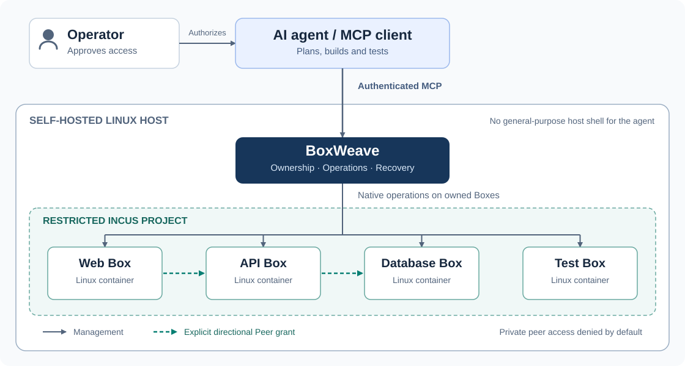

# BoxWeave

**A self-hosted MCP control plane for AI agents working across isolated Linux containers.**

BoxWeave lets an authorized AI agent create and operate a group of Incus containers ("Boxes"), run code and tests, connect workloads, and recover operation results after a disconnect. The agent works inside owned Boxes, not through a general-purpose host shell or an Incus administrator account.

## What you can do

- Create, inspect, start, stop, resize and remove owned Linux Boxes.
- Clone repositories, edit files, install dependencies, build and test software inside a Box.
- Compose multiple workloads: a web application, API, database and test environment.
- Grant directional Box-to-Box access or expose an owned service through native TCP/UDP forwarding.
- Reconnect to work, retrieve original command output and exit status, or investigate an uncertain operation.

BoxWeave provides infrastructure primitives. Your agent decides what to build and how to organize its work.

Boxes deny private peer access by default. These workloads are examples, not built-in roles. Each independent nested BoxWeave installation has its own ownership and credential boundary; nesting depends on host Incus and kernel capabilities.

## Get started

1. Prepare a Linux amd64 or arm64 host with a compatible, already configured Incus daemon, storage pool and restricted per-user Project.
2. Follow the [installation guide](docs/getting-started/MANUAL_INSTALL.md). Download and verify the installer from an exact published release.
3. Connect an MCP client using a local Bearer credential or embedded OAuth through your own HTTPS endpoint. See [Connect and use BoxWeave](docs/getting-started/USE_BOXWEAVE.md).
4. Ask your agent to call host_status and box_list, then create one test Box and verify readiness before running commands.

[Download a release](https://github.com/vanishs/boxweave/releases) | [Installation](docs/getting-started/MANUAL_INSTALL.md) | [Usage](docs/getting-started/USE_BOXWEAVE.md)

**Release status:** v1 is in prerelease development. As of 2026-11-24, [RC13](https://github.com/vanishs/boxweave/releases/tag/v1.0.0-rc.13) is the latest published v1 prerelease. The v1 source branch also contains newer scoped Peer and Doctor/Recover implementations; those changes are not in RC13. Check the release page and installed build identity before using source-only features.

## Example agent request

> Create a development Box and a test Box. Install the tools my project needs inside them, clone the repository, run the tests, fix any failures and report the original command outputs. If the Boxes need to communicate, grant only the required direction. Keep the Boxes for my review.

Use operation_get to follow the original asynchronous operation and operation_output_get to retrieve guest command output and exit status. If an operation becomes UNKNOWN, inspect the original rather than blindly issuing a new mutation. A successful operation receipt is not proof that a guest test passed.

## Important limits

- A management credential grants access to owned Boxes, including guest-root execution. Keep credentials private.
- File tools support exclusive create, list and read; unsafe conditional replace/delete is refused. Use Git or guest commands for edits.
- A native forward is not proof that an application is listening or externally reachable. Omitted host binds stay loopback.
- The newer scoped Peer architecture requires an explicit fresh installation and does not support migration, upgrade or rollback. Full-only scoped retirement requires an original fresh native preimage and completed MCP cleanup; it is not in RC13. The clean-reinstall candidate adds explicit reviewed purge of completed retirement archives; never erase an unresolved original to force a fresh install. Older installations use the legacy architecture.
- Host configuration and evidence-bound local recovery remain operator responsibilities. BoxWeave is not a general host administration, cluster orchestration, backup or website publishing platform.

## Development

[Developer documentation](docs/INDEX.md) — architecture, MCP contracts, contribution workflow, current source status, acceptance evidence and historical records.
