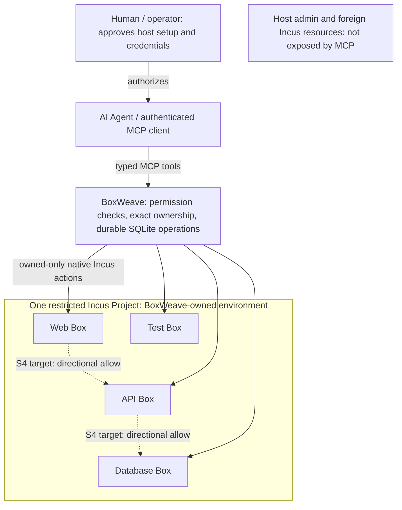

# BoxWeave

**Secure Agent-Programmable Container Environment**

**Let AI agents build and operate a group of Boxes. Keep host administration out of reach.**

BoxWeave is a small, self-hosted **MCP control plane for multiple owned Incus Linux containers**. An authorized AI Agent can create, inspect, run, update and remove Boxes inside a restricted environment, without receiving a general host shell or the host's Incus administrator socket. The Agent can compose different Boxes into an application or test setup; **BoxWeave enforces the resource and operation boundaries, not the Agent's business workflow**.

Unlike a one-sandbox-per-request service, the unit of value is the **controlled multi-Box environment**: several isolated workloads, a clear ownership boundary, durable operation results, and (as the S4 network work is accepted) explicit directional Box-to-Box permissions and limited host-port exposure.

## The environment

The roles above (Web/API/Database/Test) are **examples chosen by an Agent**, not built-in BoxWeave service types. **Dashed Box-to-Box links depict S4's intended, explicitly granted traffic**, not a claim that network Tools have shipped. The host-administration node is intentionally **not connected** to the Agent/MCP path. Incus and the kernel enforce the real container/network effects; BoxWeave checks ownership and validates their observed results.

An appropriately configured Box may itself host a separate BoxWeave + Incus installation. Each nesting layer keeps its **own** credentials, Project, SQLite and ownership boundary; kernel/AppArmor/BPF limitations mean arbitrary-depth hostile isolation is **not** promised.

## What an Agent can do

| Capability | Public interface and scope |
| --- | --- |
| Manage owned Linux Boxes | `box_create`, `box_list`, `box_get`, `box_update`, `box_start`, `box_stop`, `box_delete` |
| Develop and test inside Boxes | `box_exec` with bounded guest argv, environment, output and timeout; `box_file_list`, `box_file_read`, safe `box_file_apply` |
| Recover and inspect operations | `operation_get`, `operation_list`, `operation_output_get`, `operation_cancel`; original Tracking IDs and idempotency keys |
| Inspect this controller | `host_status` (read-only; not a general host inventory) |
| Relate and expose Boxes | **Planned S4:** `box_peer_set` (directional peer allow/revoke), `port_forward_list/create/delete` (native TCP/UDP for owned Boxes) |

**Current merged `v1` baseline:** S1–S3 provide **16 public MCP tools**, including the safe guest-file minimum. The four network Tools, dependent Delete integration and complete 20/20 acceptance are **S4/S5 work**, not features of the merged baseline or RC.7. S4-A has separately accepted code in [Draft PR #153](https://github.com/vanishs/boxweave/pull/153) but is not merged into `v1` here.

**Important file limit:** native exclusive file create is supported. Atomic conditional replace/delete is not proven through the Incus SFTP path; `box_file_apply` returns `UNSUPPORTED` for unsafe modes. Use Git/shell **inside the owned Box** through authorized `box_exec` for larger code changes. A guest command is never a host command.

## Typical multi-Box workflow

1. **Operator setup:** on a dedicated, compatible Linux/Incus host, review the local install/preflight and native Project/Profile preparation; authorize an `admin` or read-only `viewer` MCP credential. `/mcp` listens on loopback by default. Any public HTTPS/Tunnel access is operator-managed.
2. **Create separate workloads:** the Agent creates, for example, an API Box and a test Box; each returned operation has an original ID. Read `operation_get` and the Box's native readiness before depending on it.
3. **Work independently:** use guest `box_exec` for `git clone`, dependency setup, tests and fixes. Query original operation status/output on reconnect. A failing guest test is a completed failed command, not a missing transport response.
4. **Connect only what is required (S4 target, not RC.7):** authorize API-to-database peer traffic with `box_peer_set`, and publish an owned test service via a loopback-default native TCP/UDP forward when the network features have passed their gates. Other Box pairs remain denied.
5. **Verify and clean up:** inspect exact owned Box/forward/peer state and retained operation evidence, then delete only the managed resources. After an ambiguous `UNKNOWN`, **do not blindly retry** a possibly dispatched mutation.

BoxWeave does **not** choose the application's components, run an Agent scheduler, manage Git repositories on the host, or orchestrate a cross-host cluster. It provides safe primitives for an **external Agent to compose**.

## Install, connect and learn

- **[v1.0.0-rc.7 prerelease](https://github.com/vanishs/boxweave/releases/tag/v1.0.0-rc.7)** — latest published v1 RC at this documentation snapshot; **not** a stable production release. The older `main` v0.x line is separate.
- **[Manual installation guide](docs/getting-started/MANUAL_INSTALL.md)** — reviewed local install, Incus prerequisites, native preparation, OAuth and MCP. **This guide is explicitly anchored to RC.3**; pin and verify your selected release and its CLI options rather than blindly treating the RC.3 example as an RC.7 install recipe.
- **[Documentation index](docs/INDEX.md)** and **[glossary](docs/GLOSSARY.md)** — operator and development references.
- **[Tool contracts](docs/design/MCP_TOOLS.md)** · **[Agent development loop](docs/product/DEVELOPMENT_LOOP.md)** · **[original operations/UNKNOWN](docs/design/OPERATIONS.md)** · **[nesting](docs/design/NESTING.md)**.
- **[Long-term multi-Box positioning and competitor notes — discussion PR #155](https://github.com/vanishs/boxweave/pull/155)**. The notes are **non-normative** and do not expand v1 scope.

## Security and scope

- **Host boundary:** the MCP principal can operate only exact BoxWeave-owned Incus resources. No host shell/files, foreign Box adoption, generic Incus admin API, general ACL DSL, Caddy, managed certificates, guest resident Agent or cross-layer orchestrator.
- **Credentials:** multiple revocable `admin` and `viewer` tokens and optional embedded OAuth on the same `/mcp` endpoint. `viewer` cannot execute or mutate, **but can read sensitive guest files and retained output**; protect viewer credentials accordingly.
- **Durable effects:** every admitted mutation uses a reusable client idempotency key and an original durable Operation record. Track an uncertain native result as `UNKNOWN` until independently reconciled; never assume a timeout means no effect.
- **Nested security:** host and kernel capabilities determine supported depth and isolation. The ability to run a child Incus daemon is not proof of hostile multi-tenant safety.
- **Host-global Scriptlet warning (S4 design):** the proposed restricted TLS/ACL writer may require Incus `authorization.client.tls-restricted=scriptlet`, a **daemon-global** setting that can change authorization behavior for *other* restricted TLS clients. Never enable it without explicit host-specific owner approval, compatibility review and rollback proof. It is not an ordinary Box MCP operation.

See the [permanent v1 product boundary](docs/decisions/PRODUCT_BOUNDARY.md), [network design and native limits](docs/design/NETWORK.md), [security model](docs/design/SECURITY.md) and [acceptance status](docs/development/phases/README.md). Planned features are not production security claims.

## Development

[Contributing](CONTRIBUTING.md) · [quality and protected-branch rules](docs/process/QUALITY_GATES.md) · [staged implementation](docs/process/IMPLEMENTATION_PLAN.md) · [execution checkpoint](docs/development/EXECUTION_LOG.md).
