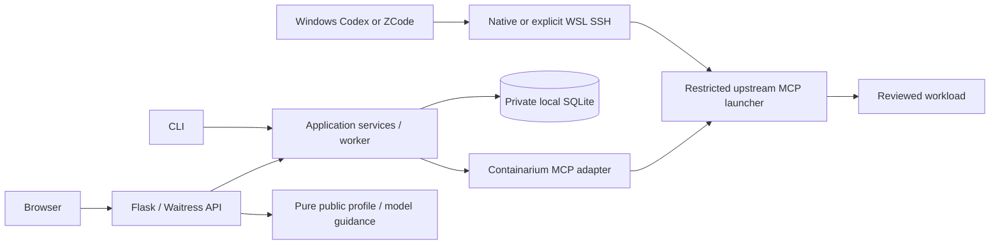

# Architecture — current implemented boundaries

This file owns the implementation map. [SCOPE](../product/SCOPE.md) owns selected outcomes, [ADR index](ADR/INDEX.md) owns decision status, and code/VERSION own actual schema/runtime versions. Historical design/checkpoint wording is preserved in [ARCHITECTURE_HISTORY](ARCHITECTURE_HISTORY.md).

The application adapter in bwmini/provider.py and access_provider.py uses the configured MCP stdio launcher, typically its own strict SSH identity to the upstream launcher. The app does **not** implement the originally proposed direct REST adapter or borrow the browser session/Agent GLM credential as Provider authority. Underlying upstream MCP may use its own API internally; its protocol names/metadata stay upstream. API/worker share private state; credential files remain outside releases. Direct Agent MCP has broader upstream authority than Web allowlisted plans; single trusted operator is a deliberate boundary.

## Source responsibilities

| Module | Owns | Must not become |
| --- | --- | --- |
| domain.py / store.py | Target/value checks, SQLite schema/transactions/revisions | Network I/O or implicit credential repair |
| service.py / lifecycle.py / access.py | Intent, one-use confirmation, single dispatch, observation and receipts | Replaying/adopting unknown writes |
| provider.py / access_provider.py / mcp.py | Exact observed upstream contract, transport bounds, capability/Guard/revision/identity checks | Generic plugin framework, version-only unlock or trust bypass |
| web.py / __main__.py | Auth/Origin/CSRF/exact request/CLI adapters over services | Arbitrary shell endpoint or a second business-state model |
| graphs.py / models.py / profiles.py | Nonexecuting composition, native model handoff and public client artifacts | Scheduler, credential collection, server-side enrollment/inference |
| distribution.py / deploy_check.py | Verified offline app releases, backup/publication/repair and honest independent checks | Provider/Incus updater, public proxy or whole-host rollback |
| web/src | Explicit reviewed plans, drafts/conflicts, receipts and public guidance | Hidden infrastructure mutations or GUI-as-enforcement |
| scripts / tests | Bounded fixture validation and separately scoped historical acceptance | Automatic live deployment or private-chat prerequisites |

Python/Flask/Waitress, React/TypeScript/XYFlow, SQLite and separate worker remain the selected stack. The API exposes only typed operations; no generic REST/domain-proxy editor or graph execution was added. Installer binds loopback and manages only owned user services; an approved external HTTPS frontend is separate. User-manager service success is not LXC boot.autostart or confinement proof.

## Invariants and reconsideration triggers

Persist intent/dispatch before external effects; unknown stays unknown without replay/adoption. Revision changes reject stale binding/action plans. Unbind preserves project/Graph/receipts and cannot cancel already dispatched commands. Transactions do not hold a remote request. Store migration is additive with consistent pre-upgrade backup; older binaries refuse unsupported schemas.

Tenant display/account/native membership are distinct. Native writes require exact authenticated local capability, full revisions and fresh enforcing Guard; stored/Guard-observed/packet-tested are different evidence. Passthrough provides no source filtering/TLS. Public setup generation never reads credential contents, connects or executes; local reviewed source/pin/runtime/ACL gates remain. Copy/export success and recognized-secret handling have explicit limits.

Revisit an ADR only with a concrete need: measured write/concurrency pressure before changing SQLite, observed transport/latency evidence before caching sessions/Guard/trust, a newly approved feature before introducing abstraction/scheduling, a changed supported runtime before changing public profile/catalog contracts, or a new exposure boundary before TLS/network changes. Repeated-looking checks at different trust boundaries are not automatically duplication. Test durations are not a performance benchmark.

Current acceptance is [FEATURE_MATRIX](../verification/FEATURE_MATRIX.md); actual/static/fixture/human/prior evidence and remaining operational risks belong to their report/register, not repeated architecture status paragraphs.
