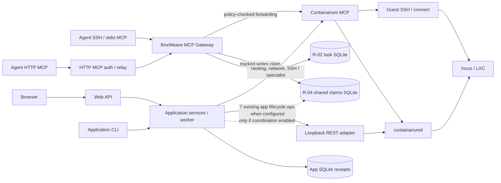

# Architecture — MCP-first + REST-assisted hybrid (current implemented boundaries)

**Owner-selected architecture policy (2026-11-05): MCP-first + REST-assisted.** Upstream Containarium MCP remains the **default integration path for new and specialist Provider operations**, while direct REST is a **selective auxiliary adapter** for justified typed application flows. The seven existing app-owned REST lifecycle operations (`list/get/create/start/stop/delete/resize`) remain unchanged and must **not** be automatically routed back through MCP. Agent-facing SSH/stdio and authenticated HTTP MCP remain first-class. The previously proposed bulk migration of 8+21 remaining MCP interfaces to REST and universal API-first architecture are **abandoned**; [PR #77](https://github.com/vanishs/boxweave/pull/77) was merged then reverted (`020ebfe8` / `e19e60bb`). Any new direct REST route requires a specific demonstrated benefit, authenticated deployed API/shape/permission checks, safety/UNKNOWN parity and explicit approval. **Transport preference never bypasses R-04 claims, authorization or trust checks.**

This file owns the implementation map. [SCOPE](../product/SCOPE.md) owns selected outcomes, [ADR index](ADR/INDEX.md) owns decision status, and code/VERSION own actual schema/runtime versions. Historical design/checkpoint wording is preserved in [ARCHITECTURE_HISTORY](ARCHITECTURE_HISTORY.md).

**Current source snapshot:** v0.44.9. For the detailed source-mapped diagram, ingress-to-Provider table, R-02/R-04 storage and guard boundaries, coverage states, and priority-ordered acceptance gates, see [Runtime entrypoints and call chains — v0.44.9](RUNTIME_CALL_CHAINS_0449.md). The [latest exact-version acceptance](../verification/REACCEPTANCE_0449_2026-11-05.md) must be read separately; diagram arrows are not a production-host runtime attestation.

The app's `bwmini/provider.py` **has a bounded direct REST adapter** (`provider_rest.py`) when `provider_api` is explicitly configured: basic application lifecycle list/get/create/start/stop/delete/resize goes through authenticated loopback `containariumd` REST where supported. Nesting-enabled create, specialist Tenant/Guard/route operations, and identity/guest command execution still use the upstream MCP path. The standalone Agent gateway retains the upstream MCP tool catalogue subject to explicit policy. SSH/stdio and authenticated HTTP MCP enter the **same** Gateway, but Web/CLI enter independently through application services. This is the implemented **MCP-first + REST-assisted hybrid**, not a universal REST replacement; the seven existing app REST methods are an explicit retained exception to the default integration preference.

The Gateway's tracked task path and the app's opt-in shared claims are mediated through the same reviewed-identity coordinator SQLite when configured correctly. Gateway **protected mode** is a separate root-owned tool-policy gate: without it, legacy forwarded Provider mutations are not automatically coordinated. Application `coordination.enabled=true` is independently opt-in; both channels must share trusted Provider scope, target identity, permissions and effective coordination storage. The upstream Provider's own direct CLI/REST/MCP and Incus operations are outside BoxWeave's shared R-04 guarantee. As of the owner-host v0.44.8 checkpoint, `task provision` prepared metadata storage but reported `coordination_enabled=false`; the latest released v0.44.9 has passed independent isolated installation, **not global owner-host protected-mode certification**.

## Retired universal API-first alternative (historical study, abandoned 2026-11-05)

The former [API-first evolution master](API_FIRST_CONTROL_PLANE_EVOLUTION_MASTER.md) and [bulk Provider migration plan](API_FIRST_PROVIDER_MIGRATION_PLAN.md) are retained for historical comparison, **not** as implementation authorization. The proposed independent SSH Executor and universal specialist REST conversion are **not required** by the selected architecture. The existing seven app REST lifecycle operations stay implemented; unrelated native upstream MCP, guest SSH and optional agent-box behavior stay supported. The [protocol-neutral D1–D4 diagnostics study](UNIFIED_OPERATION_TRACE_DIAGNOSTICS_EVOLUTION.md) can still inform MCP and REST evidence without requiring an API-first redesign. See [ADR-003](ADR/0003-transport-and-trust.md) and the revised [ADR-010](ADR/0010-api-first-control-plane-candidate.md).

## Code-first architecture consolidation checkpoint

The [ARCH-0 review and gate](ARCHITECTURE_CONSOLIDATION_GATE.md) audits
the current flat Python package, independently installed root/SSH gateway
helpers, imported application/Provider state contracts, and the new
v0.29.0 coordination core. It proposes six **logical blocks** without
changing existing runtime trust boundaries. It is a source audit, not a
completed package reorganization or installed behavior claim. Any
subsequent extraction must preserve standalone entrypoint compatibility,
original receipts, privilege separation and release fingerprints.

## Source responsibilities

| Module | Owns | Must not become |
| --- | --- | --- |
| domain.py / store.py | Target/value checks, SQLite schema/transactions/revisions | Network I/O or implicit credential repair |
| service.py / lifecycle.py / access.py | Intent, one-use confirmation, single dispatch, observation and receipts | Replaying/adopting unknown writes |
| provider.py / access_provider.py / mcp.py | Exact observed upstream contract, transport bounds, capability/Guard/revision/identity checks | Generic plugin framework, version-only unlock or trust bypass |
| web.py / __main__.py | Auth/Origin/CSRF/exact request/CLI adapters over services | Arbitrary shell endpoint or a second business-state model |
| graphs.py / models.py / profiles.py | Nonexecuting composition, native model handoff and public client artifacts | Scheduler, credential collection, server-side enrollment/inference |
| distribution.py / deploy_check.py | Verified offline app releases, backup/publication/repair and honest independent checks | Provider/Incus updater, public proxy or whole-host rollback |
| web/src | Explicit reviewed plans, drafts/conflicts, receipts and public guidance | Hidden infrastructure mutations or GUI-as-enforcement |
| scripts / tests | Bounded fixture validation and separately scoped historical acceptance | Automatic live deployment or private-chat prerequisites |

Python/Flask/Waitress, React/TypeScript/XYFlow, SQLite and separate worker remain the selected stack. The API exposes only typed operations; no generic REST/domain-proxy editor or graph execution was added. Installer binds loopback and manages only owned user services; an approved external HTTPS frontend is separate. User-manager service success is not LXC boot.autostart or confinement proof.

## Invariants and reconsideration triggers

Persist intent/dispatch before external effects; unknown stays unknown without replay/adoption. Revision changes reject stale binding/action plans. Unbind preserves project/Graph/receipts and cannot cancel already dispatched commands. Transactions do not hold a remote request. Store migration is additive with consistent pre-upgrade backup; older binaries refuse unsupported schemas.

Tenant display/account/native membership are distinct. Native writes require exact authenticated local capability, full revisions and fresh enforcing Guard; stored/Guard-observed/packet-tested are different evidence. Passthrough provides no source filtering/TLS. Public setup generation never reads credential contents, connects or executes; local reviewed source/pin/runtime/ACL gates remain. Copy/export success and recognized-secret handling have explicit limits.

Revisit an ADR only with a concrete need: measured write/concurrency pressure before changing SQLite, observed transport/latency evidence before caching sessions/Guard/trust, a newly approved feature before introducing abstraction/scheduling, a changed supported runtime before changing public profile/catalog contracts, or a new exposure boundary before TLS/network changes. Repeated-looking checks at different trust boundaries are not automatically duplication. Test durations are not a performance benchmark.

Current acceptance is [FEATURE_MATRIX](../verification/FEATURE_MATRIX.md); actual/static/fixture/human/prior evidence and remaining operational risks belong to their report/register, not repeated architecture status paragraphs.

## v0.24.0 source-only remote MCP extension

A separate loopback Streamable HTTP listener (`bwmini/remote_mcp.py`) invokes the existing server-owned `mcp_gate.py` through a bounded per-request subprocess. SSH/stdio continues independently. `bwmini/remote_auth.py` stores hashed OAuth grants, API tokens and opaque URL capabilities in SQLite v12; the existing Web administrator password is used only for interactive OAuth consent, not as a shared MCP cookie. Public HTTPS is an optional operator-managed Caddy process or external proxy/tunnel. The Web `RemoteMCP.tsx` component manages issuance and revocation. Per-client role/Box policies are explicitly deferred; the current broad trusted-operator Gateway remains. Source/CI does not prove actual TLS, client, Provider or Box operation. [Master](REMOTE_MCP_MASTER.md).

## ARCH-0 source consolidation checkpoint

[Verified implementation batches and architecture ownership](ARCHITECTURE_CONSOLIDATION_GATE.md) retain six logical code blocks without a risky mass directory migration. New pure `wire_results`, `access_contract`, and `lifecycle_contract` remove Provider/worker import inversion. Reviewed coordinator modules are included in standalone Gateway helper manifests; exact instance identity requires explicit verified upstream scope. CLI, Web, SSH/HTTP and provider execution routes are unchanged. **Source/fixture PASS, installed U, shared mutation interception P1-B2 pending.**
