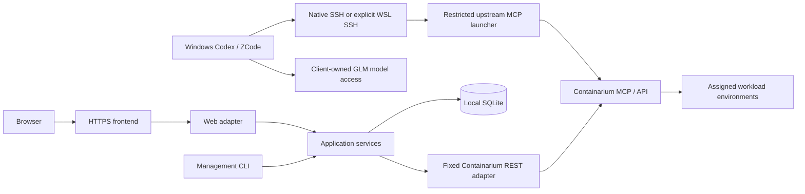

# Architecture — phase 3 design baseline

Phase6 refinement0.9.1/SRC-084..088: schema7 adds local project-unbinding tombstones while preserving projects/receipts; revisions block stale work, not cancellation of dispatched commands. Authenticated public client setup is a pure descriptor/script generator with no Provider/credential access; local existing validator still enforces runtime/source/pin/ACL/registration. Diagnostic MCP/read is independent of Store/admin and runs for empty target sets. These are fixes within the selected modular architecture, not a new credential plane or remote shell API. Independent-copy migration and original-state preservation were tested; current phase6 status supersedes historical implementation checkpoints.

Status: phase3 design with phase4 minimum chain verified and accepted SRC-051, and selected phase5 implementation/evidence completed through TASK-012/0130.9.0. Product approval: SRC-026. Requirements/criteria are authoritative under docs/product; current PHASE_STATUS and per-task evidence supersede historical gate descriptions. Provider contract SRC-010 is historical; SRC-077 separately authorizes a fresh0.120.1 test installation, not upgrading old providers. Phase6 is not authorized.

Distribution0.9.0 is an unprivileged, private-prefix Linux app package with offline hash-locked wheels, exact public source manifest, consistent state backup, owned systemd user units and atomic release publication. Credentials/database remain outside releases. Only verified app components are updated; supporting Provider/Incus/launcher/timers and global Agent settings are untouched. Web health and actual authenticated MCP/read remain independent. Existing reviewed external HTTPS frontends remain separate; the installer binds only loopback and never silently publishes Caddy/certificates. Current enabled user-manager operation is not a LXC reboot/autostart claim. See [installation](../INSTALL.md) and [selected release evidence](../verification/TASK_012_013_RELEASE.md).

Implementation0.8.0 adds schema6 access plans/claims/receipts under the existing single worker lock, server-trusted Tenant/port allowlists and actor-bound one-use confirmation. Exact native v1/Guard/full-revision upstream atomic ingress edits and app-owned TCP/UDP passthrough are adapters over the shared service. Shared membership applies only to capability-verified new creation. Configuration, Guard observation and actual packet connectivity are separate evidence levels; route acknowledgment does not promise immediate convergence. See [TASK-009/010 evidence](../verification/TASK_009_010_ACCESS.md). Unknown writes never replay or authorize adoption. No generic policy/proxy editor or existing-container reassignment was added.

## Boundaries and topology

Keep the upstream MCP transport/metadata unchanged; no new per-box server, generic gateway or control of the physical host is introduced. CLI/Web share application services for project binding, exact action plans and receipts. Agent direct MCP remains an upstream path: local Web plans do not enforce authorization on arbitrary Agent calls. Provider credentials can be broad; operator confirmation and Agent policy do not replace provider authorization. Advertise this residual authority (REQ-018).

## Stack and alternatives

Choose Python 3.12+ for the Linux application/CLI, Flask with Waitress for a bounded JSON API, local SQLite, and React/TypeScript with XYFlow for the small prompt canvas. Use a dedicated Caddy HTTPS frontend and systemd-managed API plus operation worker in deployment. Windows enrollment remains a small PowerShell artifact; WSL uses an explicit distro and its SSH identity, never an automatic distro fallback. Libraries/versions are locked only after implementation-time compatibility checks; no 'latest' upgrade is implied.

This reselects familiar tools for a single-operator transaction-oriented application, not to preserve old code. A Go service reduces some runtime deployment overhead but adds a second client-authoring language without removing Windows integration work; Node-only would unify UI/server language but adds process/credential handling work. Distributed queues/PostgreSQL/microservices are unnecessary for one host and low write concurrency. SQLite allows one writer; keep transactions short, never hold one over provider I/O, use bounded busy retries. Start with rollback journal + FULL synchronous, not WAL by default; measured need can revisit WAL with explicit checkpoint/backup handling. See ADR-001/002.

Waitress buffers requests and is multithreaded; set proxy/app body limits and return operation IDs promptly. No long-lived streaming or WebSocket dependency. Poll receipts with a bounded cursor/offset. Official rationale: SRC-028; no performance benchmark exists.

## Modules and ownership

| Component | Responsibility and test seam | REQ coverage |
| --- | --- | --- |
| Client adapters | Profile selection, managed config merges, source verification, diagnosis, native model-settings handoff; inject process runner/clock/config filesystem | REQ-001, REQ-002, REQ-003, REQ-015, REQ-016, REQ-017 |
| Target/project service | Bind/revalidate scoped resource and remote workspace, revision conflicts, safe unbind; inject inventory and identity reader | REQ-004, REQ-010 |
| Operation service + worker | Preview, confirm, persisted intent, lease/dispatch, bounded observation/reconcile; inject provider/runner/time | REQ-005, REQ-006, REQ-007, REQ-018 |
| State repository | Projects/bindings/plans/receipts/audit/graphs/session transactions and migrations; test against real temporary SQLite | REQ-007, REQ-010, REQ-011, REQ-014 |
| Provider adapter | Explicit Containarium calls, strict schemas, exact scope, capability + Guard freshness, no generic URL proxy | REQ-004, REQ-005, REQ-009, REQ-012, REQ-013, REQ-018 |
| Web API/UI | Local admin/session/CSRF/Origin; project/box/Tenant/route views; prompt canvas; setup-profile guidance, never secret model config | REQ-011, REQ-012, REQ-013, REQ-014, REQ-015 |
| Installation/diagnostics | Staging, settings, immutable manifest, service readiness, backup/repair; provider/MCP/Web credentials separated | REQ-002, REQ-008, REQ-009, REQ-016, REQ-017 |

Worker credential boundary: the operation worker runs as a dedicated unprivileged application account with its own protected provider credential, using the upstream MCP backend through its supported token-file launch interface for identity/command actions. It does not open the existing SSH launcher's MCP token or borrow the browser session as provider authority. Web requests only enqueue allowlisted actions; the worker validates actor/plan/target again. REST uses the independent application credential plane. Shared application state is permissioned to only the API/worker accounts, and no token is stored in SQLite. Provider contract/launch support and required scopes must be verified in TASK-003 before the real slice; failure is a compatibility blocker, not permission to grant host shell access. The Windows Agent's SSH launcher remains independent. SRC-002 includes the legacy token-file launch pattern as static evidence, not a fresh runtime test.

No plugin registry before a second provider; implement a small typed provider boundary and fake for tests. New source layout is decided when scaffolding the vertical slice, not copied from legacy folders.

## Data model and invariants

| Record | Key fields and invariant |
| --- | --- |
| Project | random immutable id, display name, revision; display rename never changes target |
| Binding | project id, provider connection id, backend/project, logical and observed instance identity, creation/config fingerprint where available, expected user/hostname, remote workspace, revision; IP/UUID alone is insufficient; verification is a timestamped observation |
| Action plan | id, actor, exact action + normalized targets/parameters, expected revisions/fingerprints, expiry, confirmation digest; no credentials; one-use confirmation |
| Operation/item | id, actor, plan id, state, phase deadline, intent, dispatch marker, lease generation, provider reference if any, evidence timestamps, command exit nullable, truncated-output flag and reconciliation state |
| Tenant metadata | local id/name + immutable declared provider key/revision; provider membership/Guard remain independent observations |
| Graph | id/revision, prompt, bounded cards/links/comments, contextual references, copy events; no execution semantics |
| Audit/session | actor/action/target/result codes/time; hashed session id, expiry, CSRF state; secrets and raw provider responses excluded |

Enable foreign keys, transactional revision checks and supported schema version. CAS updates reject stale writes with conflict; never overwrite silently. Deletion refuses referenced metadata; unbind does not delete resource or data. Database and secrets are outside replaceable releases. Backup uses SQLite backup API or a quiesced consistent snapshot, not copying an active database arbitrarily. Secret files are not archived into general backups.

## State, dispatch and concurrency

Plan -> confirmed/queued -> dispatch-intent -> submitted/observing -> succeeded, failed or unknown. Provider resource state (Running etc), transport readiness and command outcome are separate evidence fields. A worker atomically claims a queued item and commits intent before a provider call. Once dispatch-intent is committed, a worker crash before/after send is ambiguous: startup marks it unknown and reconciles; it never resends automatically. A DB lease prevents normal duplicate dispatch but cannot make an external write exactly-once. Expiry of a lease is not permission to replay. Cancellation before dispatch can cancel a queue item; after dispatch it requests local cancellation and leaves external completion unverified until observed.

Use a single mutation worker initially, including CLI-submitted mutations. Concurrent Web request threads only enqueue/observe. Full revisions/fingerprints are rechecked before dispatch; a provider reference/creation identity must agree with the planned target. Operator action to issue a new intent after reconciliation is explicit and audited. Create query absence alone does not close unknown as failed. Non-idempotent arbitrary commands are never resumed/replayed by receipt lookup.

Persist phase start/deadline in UTC with a fixed allowed budget; use monotonic elapsed time during a running process. On restart, consume recorded remaining wall-clock allowance; detected clock rollback/invalid deadline causes incomplete/manual reconciliation, not a fresh budget. Defaults: 600 seconds per provisioning/readiness phase, 15-30-second polls, bounded individual HTTP/SSH calls. Actual transport format parsing and cancellation require real tests, not assumptions. See ADR-002.

## Interfaces and errors

Design-only API: /api/projects and /bindings use versioned schemas + revision/If-Match; /api/plans previews; POST /api/plans/{id}/confirm consumes a matching unexpired plan and returns 202 + operation id; GET /api/operations/{id} observes; POST /api/operations/{id}/reconcile performs observation only. /api/tenants, /api/ports, /api/graphs and /api/capabilities expose explicit selected operations. No user-controlled upstream path/host/command proxy. The worker accepts only named actions with typed arguments, not arbitrary Web shell strings. CLI uses the same application contracts/repository and queue.

Errors include stable code, stage, operation id if applicable, retry class, safe summary and evidence time. Codes: INVALID_INPUT, AUTH_REQUIRED, TRUST_MISMATCH, TARGET_CHANGED, REVISION_CONFLICT, CAPABILITY_UNSUPPORTED, GUARD_STALE, DEADLINE_EXCEEDED, PROVIDER_REJECTED, OUTCOME_UNKNOWN and OUTPUT_LIMIT. HTTP 400/401/403/409/422 distinguish input/auth/conflict/unsupported; an accepted operation's terminal/unknown state is in its receipt, never inferred from HTTP 200. CLI exit 0 = requested observation/submission completed, 1 = observed failure, 2 = incomplete/unsupported/input, with command exit a separate nullable field. Redact at typed boundaries; don't echo raw credential-bearing upstream stderr.

## Client profiles, model wizard and trust

Four release profiles: Windows-hosted Codex/native, Codex/WSL SSH, ZCode/native, ZCode/WSL SSH. Keep agent config on Windows for these profiles; WSL owns its SSH files. Explicit distro and runtime-correct path/null-device/quoting rules are part of profile identity. WSL-hosted Agent CLIs remain outside this matrix. Inspect selected config only; unsupported TOML/JSON forms require manual migration instead of deleting unrelated settings. New Agent versions/config precedence need fixtures and actual UI evidence. Don't execute arbitrary commands found in untrusted configuration during diagnosis.

ZCode adapter writes only the documented MCP registration subset; GLM wizard selects provider/model metadata and hands sign-in/secret entry to the client-owned supported interface. A stable documented native configuration path may permit verified atomic setup; otherwise explicit Settings handoff with pending completion is the baseline. Unsupported automation blocks that automation claim, not a hidden fallback to another Agent. No client model key is submitted to Web or stored in the server DB. See ADR-004 and SRC-027.

Enrollment package: small reviewed bootstrap plus exact payload digests embedded in a trusted descriptor/artifact delivered by the operator through an authenticated channel. Downloaded bytes are checked before execution; a digest fetched with the untrusted payload is not authentication. Identity pinning and digest verification are separate. An edited payload/digest pair requires a new operator trust decision. Phase 4 must prove a tampered payload cannot run. No automatic code execution from branch-head downloads. See ADR-003.

## Basic feature service contracts

Web login/session is required for all privileged APIs, including operation queries. Password initialization/reset is local interactive; no password argv. Backend binds loopback; HTTPS frontend enabled only on a separately authorized address/port. Origin/CSRF, secure cookies, request caps and throttling apply; SSH MCP stays independent of Web availability.

Tenant service implements SRC-010 native contract through authenticated capability/fresh Guard evidence. Shared new-box membership is assigned before start; ingress grant/revoke uses provider atomic revision-checked policy edit with readback. No app-side emulation of atomicity with multiple independent writes. Unknown/old provider remains read-only; operator must approve compatible provider upgrade separately. Configured/Guard-verified/TCP-tested remain different statuses.

Port service supports exact TCP/UDP passthrough add/list/remove with conflict/target recheck and exposure plan. It cannot advertise LAN-only source filtering/TLS absent independent enforcement. Graph service supports bounded cards, comments, undirected links, optimistic revisions, escaped Markdown and copy-success events only after clipboard success. Model service never proxies inference or credentials.

## Minimum vertical slice for phase 4

Use one preexisting dedicated workload, one Windows Codex/native SSH profile and one project. Operator authenticates to a minimal Web page, selects a provider-observed resource, creates a revisioned project binding in real SQLite, and runs a fixed read-only identity + hello command through the verified MCP connect path (not arbitrary Web shell). Show real stdout/exit in a durable receipt; reload/restart observation finds the same binding/receipt without replay. The phase 4 slice does not create a box, publish a port, change policy or invoke GLM. These remain mandatory release features delivered by later tasks, not removed from scope.

Failure demonstrations: pin/identity mismatch prevents command dispatch; receipt persistence or worker uncertainty never reruns the command; stale binding revision conflicts. Start with a fake provider to verify write counts, then a separately authorized real target. No original project container may be adopted merely from its name. Phase 4 decides assigned LXC through fresh inspection and agreed scope. This slice validates storage/UI/service/MCP boundaries without testing every feature.

## Phase 4 unanswered assumptions

Real Windows config merge/UI loading; WSL process-tree cancellation/quoting; ZCode GLM supported setup path; provider connect receipt parser and exact resource identity; current Tenant atomic capability; proxy address/client reachability; crash-window recovery; package-integrity bootstrap. [Test strategy](../verification/TEST_STRATEGY.md) defines low-cost experiments. None ran in phase 3. [Implementation plan](../process/IMPLEMENTATION_PLAN.md) maps every requirement to tasks.

## Phase 4 implemented subset

See [ADR-005](ADR/0005-phase-four-boundary.md) and [actual evidence](../verification/VERTICAL_SLICE.md). The minimum application implements real HTTP/React/SQLite/worker behavior with explicit fixture infrastructure, a bounded MCP adapter, and a partial native connection probe. Missing independent application launcher/credential and real native enrollment/registration prevent the real slice gate from passing. Loopback fixture HTTP and project/binding row consolidation are documented implementation limits; no production HTTPS/service identity or broad feature completion is implied.

## Current result — real chain verified (SRC-049/050)

Version 0.1.1 fixes a real queue-claim timing race. Thirty Linux tests pass, including a new regression that failed before the fix. An explicitly approved nesting-enabled backend now supports the real application -> independent managed MCP -> inner workload path. HTTP and Chromium binding/confirm/hello/receipt/restart/no-replay plus live trust/identity rejection passed. See [LIVE_MCP_CHAIN](../verification/LIVE_MCP_CHAIN.md) for exact identities, operation IDs, versions, commands and limits.

The previous missing-launcher/nested-startup blocker is resolved for this new lab only, not the old box or every LXC. TASK-005 selected Web path has live evidence; real Windows-native enrollment/Agent GUI acceptance remains incomplete. Developer required this real chain before phase 5 (SRC-048); no phase 5 feature was started and architecture/slice acceptance must still be recorded before TASK-011 or other new features. Original published demo remains fixture; isolated test servers are stopped, resources retained, no new public port or host-security change.

## Phase 5 iteration 1 complete — TASK-011 (SRC-051/052)

Developer acceptance of the minimum architecture/slice is explicitly recorded in SRC-051, after verified real Web/MCP evidence. TASK-011 basic Prompt Graph is implemented in 0.2.0: bounded cards, editable comments/context, undirected links, revision-checked persistence, conflict-preserved drafts, Markdown/clipboard handling and graph-only deletion. REQ-011/014/016 and AC-011/014/016 graph subset are evidenced; other selected-feature/client obligations remain incomplete.

Actual non-root project-LXC checks: 41 tests OK (11.173s), TypeScript/Vite build, final Chromium graph workflow including mobile fit and clipboard failure, original project hello/restart fixture regression; all exit0. Graph API forbids provider access in tests; browser has zero queued/executed operations. Thirteen changed source/lock files match remote SHA256. See PHASE_05_TASK_011.md for commands and precise evidence. No new box, infrastructure mutation, deployment, persistent listener, public route or push. Stop this iteration.

Next suggestion: finish TASK-003/005 minimum actual Windows-native enrollment/recognition evidence, then dependent TASK-006. Developer gate acceptance does not fabricate those missing client checks or waive per-task prerequisites. Phase 5 overall is not complete.

TASK-002a0.2.3: local receipt history adds a bounded creation-time/ID seek cursor over actor-scoped summaries and existing detail; Web/CLI share the service. Authentication remains the existing single-operator session/local-state boundary. Query never invokes worker/provider/recovery. Existing latest/list interfaces retained, no schema migration or new service. See ../verification/TASK_002A_RECEIPT_HISTORY.md.

TASK-006 / SRC-069 / 0.5.0: scoped lifecycle plans, single dispatch, pinned managed environments, schema4 recovery, Web/CLI receipts and config-scope guards implemented. 82 non-root Linux tests and Chromium fixture passed; first actual five-action Web/MCP cycle passed. Final repeat correctly stops TRUST_FAILED after reused-IP mismatch; trusted reconciler reports failure and was not repaired or bypassed. Approved exact test resource cleanup read back absent; original hello preserved. See docs/verification/TASK_006_LIFECYCLE.md for separate success/failure evidence and limits. Continue TASK-007 under SRC-066; no full release claim.

TASK-008 / SRC-073..075 / 0.7.0: native-guided GLM wizard complete in selected scope; schema5 revisioned public intent, shared CLI/Web, native credentials only and operator report distinct from inference.106 tests/build/Chromium pass; user confirms Z.ai/GLM-5.3/access. See TASK_008_MODEL_WIZARD.md for independent native and fixture evidence. No model request, provider repair or public deployment. Continue SRC-072 network/ports and dependent packaging/release.
