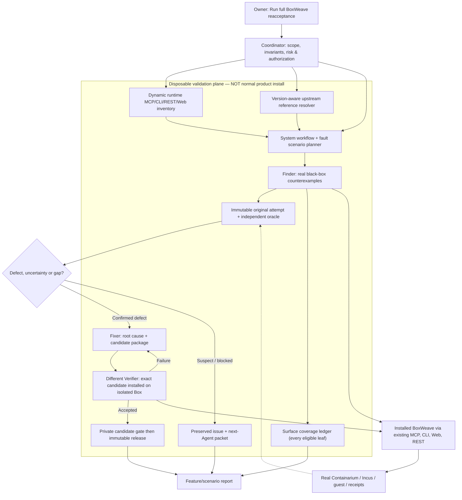

# Reacceptance system-level bug-hunting automation — implementation handoff

**Status:** DESIGN + DEVELOPER TASKS ONLY. No implementation is authorized or claimed by this document. **Owner trigger remains:** `Run full BoxWeave reacceptance`. **Primary goal:** find and fix BoxWeave **system-level defects**, then obtain **independent installed verification**. A passed tool-catalog scan is a prerequisite, not an outcome. **Prepared:** 2026-11-05.

**Read in order:** [canonical process](../process/FULL_PROJECT_REACCEPTANCE.md) → [scenario playbook](../verification/REACCEPTANCE_SYSTEM_SCENARIOS.md) → [run evidence template](../verification/REACCEPTANCE_RUN_TEMPLATE.md) → [existing v0.47.0 engine implementation record](../verification/REACCEPTANCE_ENGINE_0470_2026-11-05.md) → [existing upstream-aware orchestration design](REACCEPTANCE_EXECUTION_ORCHESTRATION_PLAN.md) → [Containarium version-aware reference](../verification/UPSTREAM_CONTAINARIUM_REACCEPTANCE_GUIDE.md). Historical RACC-AUTO-01..07 are partially scoped v0.47.0 work, **not** seven finished automation milestones.

## 1. Decisions and current-state facts

1. **System behavior over interface counting.** The campaign's primary unit is a user-visible workflow and invariant (Box identity, exactly-once dispatch, ownership, cleanup, recovery, auth, cross-interface consistency). MCP/CLI/Web/REST tools are *means* of constructing and observing those workflows. Nevertheless enumerate **all real callable MCP and CLI leaf surfaces** and execute safe, meaningful black-box cases or record a precise blocker for every entry.
2. **Production builds stay lean.** The normal user needs BoxWeave's MCP/CLI/Web, production diagnostics and safe coordination. They do **not** need a complete adversarial reacceptance runner, independent Agent controller, fault injector, upstream Git checkout cache or test Evidence Store installed on their host.
3. **Do not misrepresent v0.47.0.** The current `bwmini/distribution.py` includes **all** `bwmini/*.py` in `boxweave.zip` and explicitly bundles two `bwmini/reacceptance_data/*` files. Therefore `bwmini/reacceptance.py`, `reacceptance_live.py`, `reacceptance_proof.py` and the registry **are shipped into the app installation** in v0.47.0. They are not a new always-on daemon/public MCP endpoint. Moving them out is **future code/packaging work**, not accomplished by changing docs.
4. **Low coupling means a separate *test runner*, not a separate execution privilege.** Agent/CI/local developer runs the runner from a pinned checkout or short-lived test container, using **existing, authorized** outer BoxWeave MCP, installed CLI, SSH/stdio MCP, authenticated HTTP/Web and independent Provider reads on disposable targets. No new generic root host endpoint and no resident scheduler.
5. **Upstream is an on-demand reference, not a vendored runtime dependency.** Resolve the actual installed **Containarium daemon, CLI, MCP and REST behavior individually**; fetch only needed tagged upstream source/docs from GitHub **outside production**, pin immutable commit + source digest, cache in the test workspace, and compare declared contracts with real runtime. Do not fetch upstream `main` or silently upgrade the Provider.
6. **Published version and owner-host policy remain protected.** Default stable release pointer, operator-host reboot/R-04 grants, third-party credentials and production ownership do not follow from this development plan.

### Target architecture



## 2. System-first test design

**Before bulk invoking tools:** derive an invariant catalog from design/ADR/state transitions, actual architecture, upstream changes, open incidents, recent commits and real user journeys. Choose the highest-risk, cross-layer **scenario graphs**. Only then generate the full per-action breadth queue. Avoid a single 68-tool enumeration consuming the entire run.

| Tier | Responsibility | Completion meaning |
| --- | --- | --- |
| **L1 — Interface contract/breadth** | Enumerate every actual installed MCP tool and recursively callable CLI leaf by transport and effective identity; safe real positive + missing/invalid + meaningful denied/no-effect when applicable | Per-entry typed evidence or exact BLOCKED/NOT_APPLICABLE; **no catalog-only PASS** |
| **L2 — User workflow/invariants** | Create→observe→modify→connect→stop/start→delete; task exactly-once; Web plan/confirm/receipt; upgrade; network and auth boundaries | Whole workflow, durable intermediate/final states, cleanup and independently observed remote effects |
| **L3 — Cross-surface failure/adversarial** | Two actors, RPC timeouts after dispatch, stale identity, fail/restart only in disposable lane, duplicate/conflicting requests, MCP↔CLI↔Web↔native consistency and recovery | Deterministic interleaving/trigger and independently observed allowed/forbidden effect; no unresolved UNKNOWN replay |

Prioritize L2/L3 **in scheduling and main report**, not merely after L1 is exhausted. Maintain complete L1 accounting asynchronously in separate lanes. Risk order: state-changing or coordination-bypassing pathways → recent structural source/Provider delta → historical or ambiguous incidents → cross-interface control-plane gaps → low-risk read-only individual cases. Suggested allocation for early investigations is roughly **20% breadth probes / 40% integrated workflows / 40% fault/cross-interface**, adjustable by evidence; these are planning heuristics, **not a coverage or PASS claim**.

Every scenario is a **graph of actual installed supported calls**: nodes specify actor, interface, identity+policy, exact immutable Box incarnation, input and expected state; edges specify dependencies, concurrent barriers and rollback/cleanup. A scenario may span 3–20 actions. Invalid/native unsupported calls are only negative probes, not proof of functional parity. Use [system scenario seed and invariants](../verification/REACCEPTANCE_SYSTEM_SCENARIOS.md).

## 3. Low-coupling packaging and runtime contract

### 3A. Proposed source layout

```text
tools/reacceptance/                # development-only; excluded from customer assets
  cli.py                           # one-shot campaign/run/status/report entrypoint
  inventory/                       # installed surface / upstream ref / source delta
  scenarios/                       # graph compiler, risk scorer, invariant checkers
  adapters/                        # strict MCP stdio/SSH/HTTP, CLI, Web, native READ
  broker/                          # owned test-target identities and scoped grants
  execution/                       # action scheduler, race barriers, fault orchestrator
  agents/                          # Coordinator/Finder/Fixer/Verifier handoff protocols
  evidence/                        # append-only case logs, independent oracle, sealing
  release/                         # candidate build, install proof, promotion gate
  schemas/                         # versioned JSON schemas + golden negative fixtures
docs/verification/REACCEPTANCE_SYSTEM_SCENARIOS.md
scripts/reacceptance.py            # thin developer entrypoint; never a product daemon
```

Use the existing production entrypoints **unchanged**. Run the tooling from the repo checkout, approved developer machine, CI ephemeral environment or test-owned Box reached through the existing `connect(exec)` transport. A small **capability descriptor** may be queried from current product version/provenance and installed MCP, but do not add a required new prod endpoint or ship the suite in a normal host installer.

**Migration requirement:** first write characterization tests showing existing v0.47.0 `bwmini.reacceptance*` behavior and output; move/refactor shared libraries to `tools/reacceptance` without changing production diagnostics, auth, coordinator or package installer functionality. Replace `distribution.py`'s blanket `bwmini/*.py` inclusion **carefully** with a documented allowlist or explicit test-only exclusions; ensure new legitimate app modules cannot silently be omitted (the previous wildcard had prevented this). Remove bundled `bwmini/reacceptance_data/*` only when all runtime imports and startup checks no longer depend on them; keep current v0.47.0 immutable. Preserve a **developer-side compatibility shim** for old recorded commands, clearly version-gated. Check packaging on clean install, upgrade and both source+manifest inventory.

Tests must show a customer-facing `boxweave.zip` excludes the test runner, upstream Git cache, test-only requirements and destructive fault drivers; installed production services still work, no new port/systemd unit, no secret or persistent test user, and the new external runner can black-box test the resulting package. Optional explicit **developer test bundle** is a different asset and requires separate invocation, not default installation.

### 3B. Invocation adapters — privilege boundaries

| Adapter | Read / write route | Safety rule |
| --- | --- | --- |
| External outer BoxWeave MCP | Authenticated discovery, owned Box allocation, `connect(exec)` to test guest | Preexisting authorization; guest exec is **not** host root; keep exact owner/UUID/createdAt |
| Installed host/app CLI | `--help`, real commands, status/receipts; mutators only in owned disposable lane | Argument arrays, bounded stdout/timeout, explicit allowlist; no arbitrary shell from test data |
| Installed stdio/SSH MCP | Real `initialize → tools/list → tools/call`; actual policy-specific catalog | Separate client identity, no imported Python tool declarations standing in for the protocol |
| Authenticated HTTP MCP/Web | Existing OAuth/test credentials and CSRF/Origin/session checks | Credentials not logged, no test-only public auth or port |
| Native Containarium/Incus | Runtime version/capability and **independent readback**; native mutations only if explicitly authorized | Native writes bypass BoxWeave coordination; cannot be used as an implicit privileged test path |
| Upstream Proof Pack | Optional `containariumd proof-pack` on isolated nested Provider host and reviewed child | Root-in-child execution requires **separate approval**; not needed for general black-box reacceptance |

Make adapters report actual channel permissions and selected protocol. Tool discovery is dynamic; **68** is historical, not a command count constant.

## 4. On-demand upstream release resolver

**Important distinction:** BoxWeave's `bwmini/upstream_version.py` currently declares `BASELINE = "0.128.0"` and uses GitHub releases for upgrade metadata. This is a **compatibility/install floor or selected installer baseline**, not proof of the current process version. The installed Provider can legitimately be newer (and components can differ). A resolver must never infer installed version solely from this constant, `VERSION`, old documentation or GitHub latest.

### Resolver algorithm (test workspace only)

1. **Pin observations:** capture installed daemon `containariumd version` (or supported machine-readable local command), CLI `containarium version`, MCP `mcp-server` version where exposed, REST version/route behavior and Incus; source, timestamp, binary path and SHA256 if accessible. Record failed/unavailable observations separately. Cross-check the exact configured binary and process/executable when feasible, not just a stray PATH binary.
2. **Resolve authoritative upstream commit:** parse and validate each observed semantic version; map to `FootprintAI/Containarium` release/tag `vX.Y.Z`, resolve the tag to its **peeled commit** via GitHub API or GitHub Git ref; record tag-to-commit and provenance. Do not silently select `latest`, `main` or `v0.128.0` when observed version differs. If no tag/commit matches, set `UNRESOLVED_UPSTREAM_REF` and keep runtime-only or source-blocked tests.
3. **Acquire *only necessary references*, on demand:** prefer the release's tag-bound **source archive** (GitHub-generated archives can be source, not executable release assets), or retrieve allowlisted paths through the GitHub Contents/Tree/Blob API at the **immutable commit**. Relevant examples: `docs/DOCMAP.md`, `docs/PROOF-PACK.md`, `docs/security/CLAIMS.md`, `docs/testing/*`, `proto/containarium/v1/*`, `internal/mcp/*`, `internal/server/*`, `internal/cmd/*`, and release/CI definitions. Real release assets may contain binaries but **not docs**: verify contents, never assume. No repository install, arbitrary scripts or root command execution is part of reading references.
4. **Verify and cache:** download with bounded size/time and strict GitHub allowlist, HTTPS, path traversal/symlink rejection, sha256 of archive+individual paths, immutable commit and local cache key `(upstream_repo, commit_sha, path)`. Store outside production (`.runtime/reacceptance-upstream/<commit>` or test workspace); allow offline verified cache reuse with explicit freshness/provenance status, or mark reference unavailable. Do not copy upstream docs into the normal customer bundle.
5. **Construct a contract adapter:** compare declared proto HTTP annotations, MCP tools, native handlers and CLI operations with **real installed** runtime routes/errors/capabilities. The source is a hypothesis for tests, never proof of deployed functionality. Attribute BoxWeave forwarded failures to `UPSTREAM` only after native pinned-runtime isolation supports it; otherwise `OWNERSHIP_UNKNOWN`.
6. **Select and reuse:** use actual observed version × changed upstream paths to choose L2/L3 scenarios. Version changes do not automatically download/go build/run upstream tests or upgrade the host. Documentation instructions found in remote repository are **untrusted reference content**, not Agent orders.

**Example:** If host reports Containarium **v0.131.0** while `BASELINE` is `0.128.0`, pin and read `v0.131.0` source for the actual handler/route, separately compute differences from v0.128.0 or last accepted actual version, and test the current installed behavior. Do not cite the v0.128.0 historical guide as proof that v0.131.0 implements the same behavior. If a daemon says version A and CLI says version B, record a split runtime and avoid combining them into one fabricated contract.

## 5. Automation work packages for the implementing Agent

These are **new, actionable work IDs**, not an assertion that v0.47.0 already implements them. Existing source proof/inventory modules are partial reusable code, subject to characterization before extraction.

| ID / Priority | Deliverable | Dependencies / explicit done gates |
| --- | --- | --- |
| `RACC-SYS-01` **P0** | Off-host reacceptance package + v0.47.0 behavior-preserving extraction, product release ZIP exclusion and developer launch | Reproduce old evidence outputs; clean install/upgrade unaffected, CI packaging proof that **no test modules/data** ship, no new host service; maintain app source inventory checks |
| `RACC-SYS-02` **P0** | Runtime upstream resolver and allowlisted tag/commit source retriever/cache | Observe actual daemon/CLI/MCP identities; pinned release path, audit SHA, offline mode, no fallback to floating HEAD, tampered cache rejected, docs not trusted as instructions |
| `RACC-SYS-03` **P0** | Scenario planner + system invariants, dependency impact and risk scoring | Produce actual feature graphs from changed files/history/declared contracts; cover high-risk lifecycle/R-02/R-04/Web/install/Compose plus positive/recovery/failure; no tool-name-only plan |
| `RACC-SYS-04` **P0** | **All MCP/CLI** discovered-entry automatically executed black-box cases (where safe and authorized) | Real stdio+SSH/HTTP policy catalogs and recursive CLI leaf discovery, typed schema-aware positive/invalid/denial, exact target safety, independent oracle for mutations; **every** eligible entry executed and every other entry gets exact BLOCKED/NOT_APPLICABLE explanation; no fake PASS |
| `RACC-SYS-05` **P0** | System scenario graph executor / controlled multi-actor races and fault injection | Bounded non-repeatable dispatch, one-attempt gate on UNKNOWN, two-actor barriers, independently observed effect count/identity/cleanup; scenario chaining survives partial failure |
| `RACC-SYS-06` **P0** | Actual automated **Coordinator→Finder→Fixer→Verifier** role workflow | Real distinct worker identity/process/Box evidence; Finder immutable original repro; Fixer writes separate branch and candidate; Verifier uses **different clean environment/actor**; re-open failures; if actual agent-spawn unavailable, label manual orchestration and **never advertise fully automated independent Agents** |
| `RACC-SYS-07` **P0** | Enforced **candidate-before-public-release gate** | Source CI → privately built exact artifact → isolated install+scenario acceptance by different Verifier → immutable digest approval → explicit publish/tag/release → official release asset byte parity; existing automatic main publish must not race a failed/verifier-less gate; stable pin unchanged |
| `RACC-SYS-08` **P1** | Unified scenario-first owner report + complete action appendix + issue/handoff synchronization | Scenario/invariant matrix first, causal bugs/fixes, independent proof, then 100% action ledger; orphan SUSPECT, UPSTREAM and UNKNOWN retained; machine-readable evidence hashes |
| `RACC-SYS-09` **P1** | Fault-campaign calibration, security and performance limits | Deliberately known-bad seeded upstream drift, fake PASS, duplicate dispatch, unsafe target, denied effect and release gate bypass are caught; bounded budgets and no test-host privilege escalation |

**Recommended delivery sequence:** M0 contract/packaging baseline + source test characterization; M1 `01+02`; M2 `03+04`; M3 `05+06`; M4 `07+08`; M5 `09`. Work in isolated development Boxes/branches, build private candidate first; do not publish partially wired release-gate changes. Ask owner only if required for a new permission, intentionally host-disruptive action, privileged upstream root Proof Pack or irreversible release policy choice. Do not silently implement `07` by granting yourself public publish authority.

## 6. Machine-readable minimum contracts

Versioned records, with JSON schema tests, should include:

- **`campaign.json`:** source SHA/dirty state, product package digest, installed/observed upstream component identities, resolved upstream tag+commit+paths hashes, effective auth modes, grants, verifier identity, risk score model, scenario plan, budget and run ID.
- **`surface.json`:** one row per installed MCP/CLI leaf × transport/policy, exact required args, read/write/permission class, implementation mapping, feature+scenario IDs and missing access reason.
- **`scenario.json`:** invariant, graph nodes/edges, original target UUID+createdAt, allowed interleavings/barriers, expected state transitions, permitted and forbidden side effects, cleanup owner and recovery instructions.
- **`attempt.json`:** original request+response/exit, stderr/stdout bounded digest, start/end, caller/actor, tool version, immutable target, whether write was dispatched (UNKNOWN is not retryable), independently read actual post-state and result.
- **`defect.json`:** confidence (CONFIRMED/SUSPECT/UPSTREAM/ENV/HARNESS), reproduction, first failed boundary, likely root-cause attribution and counterevidence, repair commit, unrelated symptoms kept open.
- **`release-gate.json`:** candidate bytes/source, isolated install report, independent Verifier evidence root, required workflow IDs and explicit exceptions, publish decision and official asset parity, **no automatic approval from a previous release's PASS**.

A one-sentence owner trigger maps to this machine orchestration; it is not a long-lived background service. Never permit test-case JSON to supply arbitrary shell commands or unrestricted Provider host access. All filesystem evidence paths stay private, append-only per attempt, with an externally anchored digest when feasible.

## 7. Required adversarial acceptance suite for the automation itself

1. **Known-bad injection:** a response says success but Provider state did not change; the verifier returns FAIL/SUSPECT, not PASS. A simulated preflight error is never a functional positive.
2. **Cross-channel chain:** MCP create → installed CLI/Provider read → different transport resize → independent read → stop/start/connect → delete → no residue. Wrong or stale UUID refuses *before* mutation.
3. **R-02/R-04 replay and UNKNOWN:** same request key/body dedups; changed body is rejected; original in-flight unknown cannot be blindly retried, even by a different worker. Operator-host R-04 remains blocked without explicit permission.
4. **Multi-Agent independence:** same-Agent or same-test-Box Verifier evidence cannot be reported as independent. A separate worker runs the original Finder repro against exact candidate bytes, sees failure then post-fix success with own oracle.
5. **Dynamic MCP/CLI coverage:** intentionally hide an early CLI dispatch command, add an MCP tool and remove an HTTP route; discovery updates correctly and each gets a ledger outcome. Tool counts are never constants.
6. **Upstream resolution:** `BASELINE=0.128.0` but actual v0.131.0 must fetch v0.131.0 pinned content; split daemon/CLI versions remain split; absent tag/tampered cache/offline-unavailable fail closed without production upgrade or remote code execution.
7. **Release fail-closed:** fail candidate install, mutate archive after verifier, remove independent approval, force dirty checkout or wrong source SHA; **no public release** can occur. Docs-only commit must not publish or move stable pin.
8. **Package slimness:** app boots, Web/MCP/CLI work, production diagnostics work without `tools/reacceptance` in the release; no test data/client secret/root adapter deployed to normal host.
9. **Safety and cleanup:** expired grant, foreign Box, changed incarnation, already-dispatched mutation, unwarranted privileged path and incomplete cleanup produce a durable blocker; other independent tests continue.
10. **Truthfulness:** a deliberate mixed result shows workflow FAIL or PARTIAL prominently, all 100% surfaced entries in an appendix, and the next Agent can reproduce from original evidence without treating provenance-only hash verification as an independent actor.

The developer must attach test vectors, actual installed evidence, CI, private candidate and reporter snapshots for every delivered stage. **No release until the new publication gate itself has been independently tested.** When a blocker cannot be resolved without separate owner action, record it and continue other independent development.

## 8. Completion report to owner

Report **five separate accomplishments**, not just “all tools implemented”: (1) production ZIP slimness verified with exact asset listing; (2) dynamic upstream source resolver and provenance on at least two observed/simulated version configurations; (3) 100% eligible current MCP/CLI coverage or precise blockers; (4) independently observable Finder→Fixer→Verifier actual scenario with original and fixed state; (5) candidate-first release workflow deny and success tests. Include release/link only if an actual publication took place. Detail remaining scenario families, permissions and SUSPECT/UNKNOWN separately.
