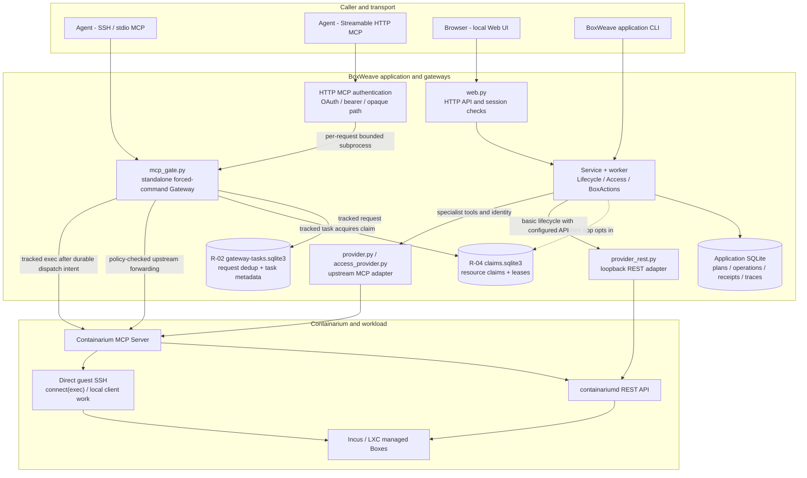

# Runtime entrypoints and call chains — v0.44.9

**Snapshot:** BoxWeave immutable source release `v0.44.9` at `0ec0dc81d8cdc69d4fb9a8abaae0615cf41e4f24`; documentation review on 2026-11-04 PT / 2026-11-05 UTC. This is a **source-backed architecture map (S)** correlated with previously recorded fixture and isolated-live evidence; it is **not** a fresh production-wide certification. The authoritative architecture owner is [ARCHITECTURE](ARCHITECTURE.md); acceptance and current risk conclusions belong to [FEATURE_MATRIX](../verification/FEATURE_MATRIX.md) and [OPEN_RISKS](../verification/OPEN_RISKS.md).

**Companion evidence view:** [five-level test evidence matrix](../verification/EVIDENCE_LAYERS_0449.md) shows which mapped call chains have source review, automated tests, isolated installed execution, owner-host acceptance or external-client proof. Graph arrows alone are not high-level acceptance evidence.

**Subsequent v0.44.9 isolated live checkpoint (not production):** a newly committed [three-entry Web/SSH MCP/HTTP MCP and actual Gateway SIGKILL acceptance report](../verification/REMEDIATION_TEST_QUEUE.md) established scoped test-only Web authenticated HTTP, pinned SSH MCP and bearer loopback HTTP MCP sharing R-04 claims, with contention denial and retained UNKNOWN. It does **not** establish normal first-admin/OAuth issuance, external TLS, owner-host enablement, Web-first in-flight claiming, natural lease expiry, immutable-incarnation replacement, bypass-free Provider routes, or historical original UNKNOWN reconciliation. Rows below that describe these combinations as unverified are a **pre-checkpoint historical call-graph snapshot**; use the [current evidence matrix](../verification/EVIDENCE_LAYERS_0449.md) for up-to-date scope.

## 1. Current execution topology

**Reading rules:** solid arrows represent implemented invocation/record relationships, **not** a claim that a call was accepted by the currently installed host. The dashed app-to-claim arrow is conditional on an explicit app configuration; tracked Gateway task submission attempts a shared claim even in legacy Gateway mode, **but unmediated forwarded writes are still allowed until the separate root protected policy is enabled**. A preprovisioned SQLite file alone is not global R-04 enforcement. The upstream MCP server has both daemon API and client-local SSH responsibilities; not every MCP operation passes through `containariumd`. The application SQLite and the two gateway/coordination SQLite stores have different contents and lifecycle guarantees.

## 2. Exact entrypoint and authority boundaries

| Ingress | Internal hop | Provider or guest execution | Identity, authorization, and special limits |
| --- | --- | --- | --- |
| Agent over SSH/stdio | Restricted SSH forced-command -> `bwmini/mcp_gate.py` | Upstream Containarium MCP; `connect(exec)` uses the upstream's guest SSH path | Per-gateway tool policy, exact managed target and host-key checks. Legacy gateway mode can forward supported upstream mutators; protected mode filters/refuses them unless explicitly classified. |
| Agent over Streamable HTTP MCP | Loopback `bwmini/remote_mcp.py` + `remote_auth.py` -> bounded per-request gateway subprocess | **Same** `mcp_gate.py` policy/transform path, then upstream MCP/SSH | Independent OAuth authorization-code/PKCE, bearer, or opaque-path credential checks; an external HTTPS origin/proxy is separately configured, not implicit. No per-Agent least-privilege RBAC. |
| Browser / Web | `bwmini/web.py` authentication, Origin/CSRF -> `Service` / background worker | Basic application lifecycle -> `provider_rest.RESTClient` **when configured**; nesting-create and other specialist paths -> upstream MCP | Actor-scoped app plans, revision checks and persistent receipts; optional `Service.shared_claims` is separate from Web login. Real authenticated installed Web HTTP write acceptance remains incomplete. |
| Application CLI | `bwmini/__main__.py` -> the same application services | Same REST-or-MCP application Provider behavior as Web | Explicit application authority, local app database, worker and plan semantics; not an implicit root Provider shell. |
| Direct upstream Containarium client / native API / Incus | **Outside BoxWeave's reviewed Gateway and app workers** | Provider native MCP, REST/CLI or underlying Incus | **Not globally intercepted by R-04.** BoxWeave's pre-dispatch disk-shrink guard and resource claims are not an upstream atomic guarantee. |

### Provider selection (implemented, not universal REST parity)

- `bwmini/provider.py` configures `provider_rest.RESTClient` only when a reviewed `provider_api` block exists. It requires an authenticated loopback URL, restricted token file and typed paths. With an eligible action, application-owned `list/get/create/start/stop/delete/resize` use REST; they still need authoritative post-write observation.
- `create` with an explicit `_nesting` option uses upstream MCP because that composite is not represented in the current REST create contract. `lifecycle_identity` and fixed guest SSH/hello still use upstream MCP; `access_provider.Wire` obtains Tenant/Guard/route operations through specialized MCP. The Agent-facing Gateway also retains upstream MCP compatibility.
- Therefore **REST and MCP are coequal, complementary channels today**. The historical future **full** API-first and independent SSH-executor plans are not proof of implemented complete migration.

## 3. R-02 task durability versus R-04 coordinated mutation

| Element | Current responsibility | Mandatory acceptance distinction |
| --- | --- | --- |
| R-02 `gateway-tasks.sqlite3` | Random request-key/payload deduplication; persisted task ID, metadata state and conservative readback. Does **not** retain guest command body or stdout/stderr. | Host `dev` owner-provisioned `task provision` and real submit/get/list/same-key and changed-payload conflict **L PASS**. Post-provision cold-reboot persistence and independent parallel distinct-key collisions **U**. |
| R-04 `claims.sqlite3` | Shared `box:<incarnation>`, scoped name, Tenant and TCP/UDP port resource claims; optional Box lease; distinct operation and lease records. | Source and protected **isolated** conflict/collision tests **T/L scoped PASS**; not automatically enforced on the owner host. |
| Gateway protected policy | Root-owned `coordination-policy.json`; protected `mcp_gate.py` filters forwarded tools and rejects unclassified/raw writes (including direct `connect`), while permitting reviewed tracked-task/lease/patch paths. | Policy must be separately reviewed and enabled; invalid installed policy fails closed. Protected mode is a capability restriction, not authentication or per-client RBAC. |
| Application protected configuration | `app_runtime.load` constructs `SharedClaims` only for explicitly configured `coordination: {enabled: true}` in live MCP mode. | The Gateway and application must agree on the same trusted Provider/backend/project, same Box incarnation and usable private-store permissions; only then can their claims contend. |
| Dispatched/UNKNOWN state | `accepted -> dispatch_intent -> observed_terminal`, or conservative `unknown`. An unobserved dispatched operation holds its claim; `dispatch_intent` or `unknown` conflict returns `RECOVERY_REQUIRED` in v0.44.9. | Lease expiry **does not release** a dispatched/UNKNOWN claim, prove termination, cancel guest work, or authorize replay. Verify the **original** write/identity and its durable receipt before reconciliation. |

**Installed owner-host reality:** `sudo boxweave task provision` returned `state=ready`, `private_metadata_only=true`, `coordination_prepared=true`, `coordination_enabled=false`. This enabled R-02 task storage, **not global R-04 protection**. No original historical `bwweb-0446`/`bwweb-0447` UNKNOWN operation, task, or claim was cleared. R-04 cannot be labeled globally PASS on the basis of its source fixtures or earlier protected isolated Box tests.

## 4. Write-entry coverage and acceptance matrix

Legend: **S** reviewed implementation/source, **T** executed fixture/CI, **L** actual isolated/owner-host operation on a named release, **U** not yet proven for the stated combination. Status is **entrypoint-specific**, not a universal pass.

| Mutating pathway | Enforced path in reviewed code | Evidence and status | Remaining gate / priority |
| --- | --- | --- | --- |
| SSH Gateway `boxweave_task_submit` | Request-key reservation -> exact target identity -> optional shared claim -> `dispatch_intent` -> fixed upstream `connect` -> durable receipt | Outer owner-host R-02 **L PASS**; protected shared contention **isolated L/T PASS**, **overall PARTIAL** | **P0:** independent cross-process collision, startup interruption and failed/UNKNOWN recovery parity |
| HTTP MCP `tools/call` | `remote_mcp` auth -> **same** `mcp_gate`; protected allowlist denies unclassified writes | Local protocol/auth fixtures and older loopback **T/previous L PASS**, external installed combined path **U** | **P0:** simultaneous SSH-vs-HTTP same-target tracked writes; external authenticated HTTP MCP **P1** |
| Web/CLI lifecycle create/start/stop/delete/resize | App plan + worker -> optional `SharedClaims.acquire_environment` -> REST unless nesting-special -> durable result observation | Lifecycle and coordinator fixtures **T PASS**, selected protected isolated app/Gateway conflicts **L PASS**; installed authenticated Web HTTP writer **U** | **P0:** Web vs SSH and HTTP MCP collisions, original target identity, failed/restarted worker |
| Web BoxAction mutators | `BoxActions` optional `SharedClaims.acquire` -> adapter; terminal receipt before claim release | Source/fixture **T PASS**, selected protected isolated lease conflicts **L PASS**; full live matrix **PARTIAL** | **P0:** competing Gateway lease, expiry, process-start acknowledgement vs terminal observation |
| Web Access Tenant / port mutators | `Access` optional `SharedClaims.acquire_access` -> specialized upstream MCP/Guard; never assume source filtering/TLS | Source/fixture **T PASS**, historical native Tenant/route observations; global concurrent acceptance **U** | **P1:** same-Tenant / same-port conflicts across interfaces and Guard revision staleness |
| Protected raw upstream write such as direct `create_container`, `resize_container` or `connect` | Gateway protected mode **rejects** uncategorized forwarded writes, rather than silently sharing a lease | Gateway allowlist / negative fixtures **T PASS**; sampled isolated protection **L PASS** | **P0:** verify **every** current tool-catalog write is denied or explicitly mediated in SSH **and** HTTP paths |
| Native Provider REST/MCP and Incus outside BoxWeave | No common BoxWeave R-04 interposition | **Excluded from R-04 claim**; native disk-shrink and create-after-error defects independently observed | **P1:** upstream fixes and independent native contract / atomicity checks; never claim blanket coordination |
| Task/read-only surfaces | `get/list/info/diagnose` and reviewed bounded reads; protected catalog is intentionally narrower | Owner-host task read and diagnostics **L PASS**; other installed clients **partial** | **P2:** pagination, restart, retention and accepted-tool matrix |

## 5. Priority-ordered next acceptance tests (no production activation)

1. **P0 / R-04 authenticated three-entrance collision:** In a disposable parent with deliberately reviewed app and root Gateway settings, run independent **SSH stdio MCP** and **HTTP MCP** sessions and a **real authenticated Web HTTP POST** against one **immutable** Box identity. Test same Box vs distinct Box; concurrent mutation and name/identity recreation; prove exact Provider state, one dispatch, durable receipts and resource locks. A sequential MCP connector call is **not** concurrency evidence.
2. **P0 / interruption + UNKNOWN:** Hold a competing task/lease, kill or disconnect the **test-only** worker after `dispatch_intent`, restart independent gateways and check the original operation, log/trace, lease expiry and new contenders. Expect no silent replay, no claim release on expiry, `RECOVERY_REQUIRED` until original-outcome reconciliation. Preserve historical incidents; use fresh test identities.
3. **P0 / bypass inventory:** Enumerate the *actual installed and authorized* Gateway tool catalog, application REST/worker writes, specialist Tenant/Guard routes and auxiliary host/Provider APIs. Classify every mutation as **coordinated**, **protected-mode denied**, **outside guarantee**, or **not yet classified**. Compare both transports and real root policy. Do not use source tool annotations as write authority.
4. **P1 / outer R-02 durability:** Independently read the exact existing task receipt after a separately authorized owner-host service restart or planned host reboot, without repeating its command. Test genuinely parallel distinct keys only in disposable targets.
5. **P1 / external auth and upstream faults:** Verify external OAuth/HTTPS client and real installed Web authority; separately reproduce original Provider create-after-error and native disk-shrink contracts under safe isolation. The latter two remain upstream issues, not automatic R-04 fixes.

**Do not** enable root protected policy on the owner host, alter Provider/Incus/firewall/SSH, clear unknown claims, restart historical Boxes or release a new version merely to validate this architecture map. A design diagram is not live acceptance.

## 6. Reviewed source and evidence anchors

- Entry router: [`mcp_gate.py`](../../bwmini/mcp_gate.py), [`gateway_protection.py`](../../bwmini/gateway_protection.py), [`remote_mcp.py`](../../bwmini/remote_mcp.py), [`remote_auth.py`](../../bwmini/remote_auth.py), [`gateway_tasks.py`](../../bwmini/gateway_tasks.py).
- Application: [`web.py`](../../bwmini/web.py), [`app_runtime.py`](../../bwmini/app_runtime.py), [`service.py`](../../bwmini/service.py), [`lifecycle.py`](../../bwmini/lifecycle.py), [`box_actions.py`](../../bwmini/box_actions.py), [`access.py`](../../bwmini/access.py).
- Provider: [`provider.py`](../../bwmini/provider.py), [`provider_rest.py`](../../bwmini/provider_rest.py), [`access_provider.py`](../../bwmini/access_provider.py).
- Coordination: [`coordination_bridge.py`](../../bwmini/coordination_bridge.py), [`coordination_runtime.py`](../../bwmini/coordination_runtime.py), [`operation_coordination.py`](../../bwmini/operation_coordination.py).
- Version-bounded acceptance: [v0.44.9 source/release/install/R-02/R-04 ledger](../verification/REACCEPTANCE_0449_2026-11-05.md), [prior protected v0.44.8 test](../verification/P1_REMEDIATION_ACCEPTANCE_0448_2026-11-04.md), [API-first migration decision](API_FIRST_PROVIDER_MIGRATION_PLAN.md). Earlier snapshots remain historical.
