# Native Filesystem — architecture walkthrough and worked examples

Status: explanatory companion to the [design and delivery plan](NATIVE_FILESYSTEM_DESIGN.md), [R0 implementation contract candidate](NATIVE_FILESYSTEM_R0_CONTRACT.md) and [measured lab evidence](NATIVE_FILESYSTEM_R0_LAB.md). The contract candidate governs proposed scope; the existing product contract governs implemented behavior. This walkthrough is not a wire-schema freeze, implementation, release acceptance, or permission to change the current catalog or database.

The aim is a resource-native, agent-friendly, offline-capable filesystem, not a thin wrapper around every SFTP verb. Incus provides the native access; BoxWeave organizes it into bounded workflows that an agent can use without generating shell scripts for every file task. Examples below use symbolic Box IDs, incarnations, paths and idempotency keys and are illustrative, not valid current RC15 calls.

## 1. Architecture: three complementary capabilities

BoxWeave remains an agentless control plane, one Go controller per layer. Compute runs programs; Network controls connections; Filesystem manages owned Guest data. All three share ownership, authorization, lifecycle coordination and durable Operations.

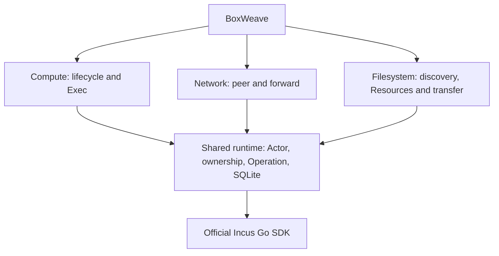

Filesystem has three MCP-facing surfaces, not three implementations.

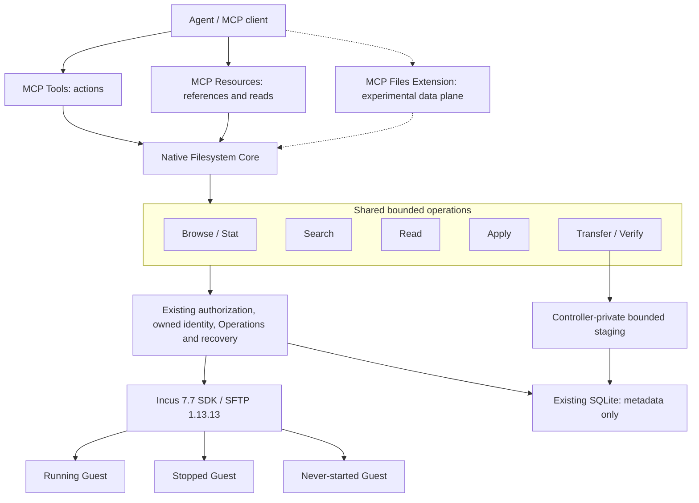

Tools express what to do. Resources identify what to read. An eventual Files adapter may move bytes independently of the model. Filesystem Core implements common behavior once, including native path policy, scan limits, identity revalidation, transfer and verification. Incus owns filesystem access, including stopped rootfs handling. No second native transport, resident Guest service, global index, additional public listener, database engine or per-agent adapter is part of the baseline.

Baseline candidate: Incus daemon and Go SDK 7.7, pkg/sftp 1.13.13, Go 1.26.10, MCP Go SDK 1.9 series development candidate. Both 1.8.0 and 1.9.0-pre.1 passed scoped core Resources tests; the stable version is a viable fallback. Exact-base combined build and short tests passed with the prerelease; stable build, vet and focused Native/Control race tests also passed. Deployment, full CI and restricted installed runtime acceptance are separate.

## 2. Direction A — MCP Resources

### 2.1 From file listing to resource references

Think of Tools as verbs and Resources as nouns. A list or search returns metadata plus references; a resource-capable client can request the actual content using standard resources/read.

Example project in an owned Box:

```text
/workspace/
  main.go            8 KiB
  server.go         32 KiB
  README.md          4 KiB
  tests/
  artifacts/
    release.tar.gz  32 MiB
```

A future box_file_list result can contain an entry such as:

```json
{
  "name": "main.go",
  "type": "file",
  "size": 8192,
  "uri": "boxweave://boxes/BOX_UUID/INCARNATION/fs/workspace/main.go"
}
```

A typed MCP ResourceLink can accompany the structured result. This example is not a frozen wire format.

```mermaid
sequenceDiagram
  participant C as Agent / MCP client
  participant W as BoxWeave
  participant I as Incus SFTP
  C->>W: box_file_list
  W->>W: Authenticate and resolve exact owned Box
  W->>I: Bounded directory metadata
  I-->>W: Entries
  W-->>C: Metadata and ResourceLink
  C->>W: resources/read (URI)
  W->>W: Reauthenticate; validate URI and incarnation
  W->>I: Bounded native read
  I-->>W: Observed bytes
  W->>W: Recheck identity and authorization
  W-->>C: ResourceContents
```

A generic ResourceTemplate is enough; registering every file in every repository would create needless state and leak private names through discovery. Candidate template:

```text
boxweave://boxes/{box_id}/{incarnation}/fs/{+path}
```

Canonical encoding, path policy, exact UUID/incarnation and layer ownership must all be checked. The URI is an identifier, not a token. Private resources use per-request auth and private, zero-TTL cache hints; legacy clients may not honor those hints. Static generic template discovery does not enumerate private filenames. No arbitrary host files or URL fetches.

### 2.2 Three client capability levels

| Client | Available workflow |
| --- | --- |
| Tools only | List/search/read/apply and bounded transfer requests. No Resources dependency. |
| Core Resources capable | Same Tools, plus ResourceLink discovery and resources/read. |
| Future negotiated Files capable | Same control contract, plus standardized client/server byte transfer where actually supported. |

Core Resources are JSON text/blob responses, not a streaming file transport. Even a binary Resource can consume model context if the client exposes it to the model. Large resources therefore return bounded metadata or references and a supported continuation mechanism, not an unlimited read or silent truncation. A reference alone does not guarantee that a client can retrieve a file. Subscription notifications are optional; the current stateless JSON transport does not gain persistent notifications or SSE keepalive just by upgrading the SDK. The experimental extension is not a baseline dependency.

R0 verified synthetic official SDK HTTP client/server interactions with both SDK versions, including templates, links, text and binary, cache hints and synthetic access refusal. Real ChatGPT or other external Agent behavior has not yet been verified.

## 3. Direction B — agent-friendly public Tools

The proposal retains three existing file Tools and adds search and transfer, taking the total catalog from 23 to 25. This requires owner approval. Existing callers keep their current behavior, defaults and result fields where compatible.

| Tool | Initial candidate | Later or deferred |
| --- | --- | --- |
| box_file_list | List, stat, bounded tree, batch stat | Unlimited or snapshot tree |
| box_file_search | Filename, literal text, bounded RE2 search | Persistent index |
| box_file_read | Bytes, text, lines, head/tail, batch, observed digest, read-only preview | Unlimited read or snapshot claim |
| box_file_apply | Exclusive create, mkdir, bounded ordered new-file batch | Existing-file edits, conditional replacement/deletion, append, move |
| box_file_transfer | Same/across owned Box copy, staged upload lifecycle, download preparation | Negotiated experimental Files adapter, advanced sync |

### 3.1 Discover before reading

Illustrative list request:

```json
{"box_id":"BOX-A","path":"/workspace","mode":"tree","depth":2}
```

The result gives a bounded tree and metadata/links. Stat is useful when the agent only needs size, type, permissions or timestamps, and batch stat combines multiple queries under one aggregate budget.

### 3.2 Search before loading whole files

Illustrative search:

```json
{"box_id":"BOX-A","path":"/workspace","mode":"text","pattern":"CreateGuestFile","limit":20}
```

For example, the agent might receive a function definition in internal/native/file.go and its call site in internal/control/file_tools.go, each with observed line number, bounded context and Resource URI. Exact results depend on the revision and actual scan. No need for grep/ripgrep in the Guest: bounded SFTP reads and Go matching permit stopped-Box searches. The tradeoff is extra native round trips and potentially slower large-repository searches compared with local ripgrep. Report incomplete coverage when hitting scan, entry, depth, time or result budgets. No-match in a partial scan is not proof of absence.

### 3.3 Read the smallest relevant region

Illustrative batch request:

```json
{
  "box_id":"BOX-A",
  "mode":"batch",
  "files":[
    {"path":"/workspace/main.go","start_line":1,"end_line":60},
    {"path":"/workspace/server.go","start_line":120,"end_line":180},
    {"path":"/workspace/README.md"}
  ]
}
```

Return concise UTF-8 text and accurate coverage under a shared aggregate output budget. Bytes remain available for binary and legacy callers. Lines and bytes have distinct offsets; preserve CRLF and UTF-8, reject or explicitly represent invalid text, handle long lines and partial EOF. Head/tail support logs. Digest computes SHA256 on the server for observed bytes, not a snapshot/revision guarantee. Preview returns a bounded diff and ambiguity/conflict information without changing the file. Preview is read-only; it does not reserve a durable editing lock.

### 3.4 Apply only supported mutation semantics

Exclusive create and bounded ordered batches of new files are the baseline. Directory create and safe metadata behavior need integrated tests. Results identify each item and observed effects; no multi-file transaction guarantee. Existing-file edit, append, move and conditional replace/delete are not silently enabled. Every admitted mutation uses its own original caller idempotency key and durable receipt. The product must not use Exec as a hidden fallback.

## 4. Direction C — online and offline native access

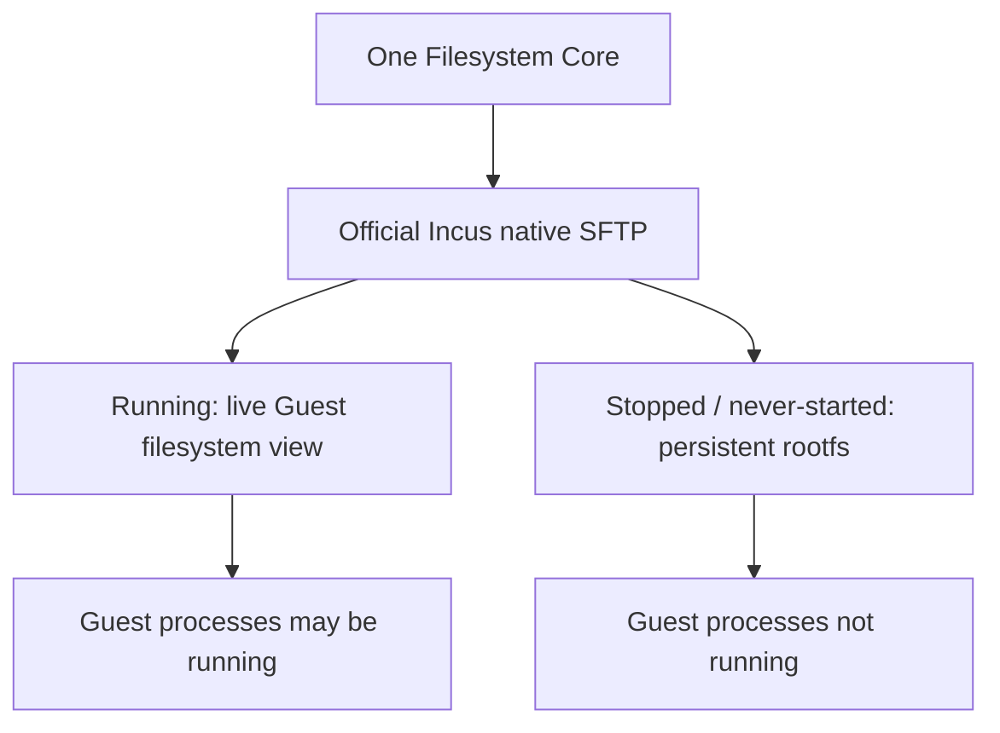

Offline means Guest stopped; the controller and Incus daemon still run. A stopped rootfs view does not necessarily contain runtime mounts seen while running. No implicit boot.

Example: create a stopped Box, prepare new source and configuration files, verify digest/permissions, close file handles, start the Box, run build/tests with box_exec. If a Box fails to boot, inspect persistent logs/configuration and retrieve source/artifacts offline. Replacing a bad existing configuration still depends on an approved modification contract.

R0 exact nested Incus 7.7 dir-backend witness:

| Observation | Scope |
| --- | --- |
| Never-started, Running, stopped-again | 1,160,000-byte read/write, offset read, digest and double-handle copy |
| Distinct stopped Guests | 8,388,627-byte copy with controlled SFTP reconnect and verified prefix |
| Stopped-to-running | 33,554,469-byte binary write/read, digest, executable permission, mtime, UTF-8/CRLF and EOF behavior |
| Lifecycle interaction | Start pending at 2 s with open stopped-rootfs read handle, completed after close |
| Directory bound | 32 KiB wire limit produced partial entries plus error, not a complete result |

Implication: no persistent cross-transition native handle cache. Bound handle lifetimes and coordinate file operations with lifecycle/resource claims. Check exact ownership, identity and native state at admission and response/effect boundaries. The observations use local Unix root/default Project on a disposable nested lab; they do not prove restricted nonroot Project, hostile path races, alternate backends or power-loss durability. Restricted installed-runtime witness remains mandatory before enabling the new access in the product.

## 5. Direction D — file transfer and independent budgets

### 5.1 Native same-Box and cross-Box copy

Historically an agent might coordinate shell scripts, Base64 chunks, temporary files, assembly, receipt polling and verification. The new route lets the controller perform these mechanical steps directly. Initially scope source and destination to the same owned layer/project.

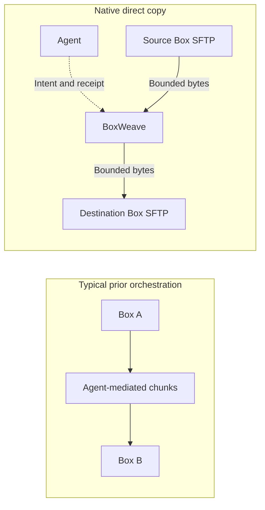

Illustrative copy intent:

```json
{
  "mode":"copy",
  "source_box":"BOX-A",
  "source_path":"/build/release.tar.gz",
  "target_box":"BOX-B",
  "target_path":"/artifacts/release.tar.gz",
  "idempotency_key":"release-transfer-001"
}
```

Controller resolves both identities, acquires affected claims in deterministic order, reads/copies with bounded buffers, validates the observed digest, publishes only under the proven write contract, and returns original Operation evidence. File bytes bypass the model; no Guest peer network grant or Guest boot is required. The destination must not silently overwrite an existing file. A mutable source is not a snapshot; consistency and resume conditions must be checked.

### 5.2 External client upload/download

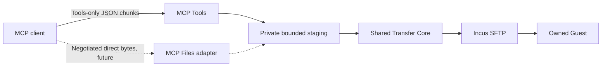

Tools-only clients can use begin/chunk/commit/abort and existing status/read mechanisms. The controller manages ranges, verification and assembly; the model may still have to carry Base64 and issue multiple requests. A future supported Files Extension can avoid that data path by moving bytes directly at the client level. Do not claim this capability before client/server negotiation and actual end-to-end evidence. Both adapters must share the same authorization, staging, receipts and publication logic. Downloads use bounded read/Resources or the future supported adapter, never an unrestricted file URL.

### 5.3 Transport budget is not native file size

R0 SDK loopback, both 1.8 and 1.9-pre1, current and legacy protocols:

| Raw data | Encoded request (approx.) | SDK result |
| --- | --- | --- |
| 2 MiB | 2.67 MiB plus JSON overhead | HTTP 200, handler called |
| 3 MiB | 4 MiB plus JSON overhead | HTTP 413, no dispatch |

Default SDK request limit is 4 MiB. Product Tool limits and real external connector limits can be much smaller. A 32 MiB native SFTP file is not evidence for a 32 MiB MCP request. Keep three independent budgets:

- MCP request/result bytes, encoded overhead and model-visible content.
- Controller scan work, concurrent native handles, stream buffer and elapsed time.
- Reserved staging bytes, retention, aggregate quota and transfer size.

See the [contract candidate](NATIVE_FILESYSTEM_R0_CONTRACT.md#4-initial-budget-envelope-for-r1-review) for conservative starting values: legacy 64 KiB inline/read cap; 32/64 KiB initial Tools-only chunks; 128–256 KiB internal stream buffers; candidate 64 MiB transfer test ceiling and 256 MiB aggregate controller reservation. These are proposed limits, not measured product or host quota guarantees.

### 5.4 Manifest and batches

For a multi-file project transfer, use a bounded manifest of normalized relative paths, sizes, digests and explicitly supported metadata. Example:

```json
{
  "files":[
    {"path":"main.go","size":8192,"sha256":"<digest>"},
    {"path":"go.mod","size":2048,"sha256":"<digest>"},
    {"path":"README.md","size":4096,"sha256":"<digest>"}
  ]
}
```

The server rejects duplicates, path collisions and unsupported entries and aggregates per-item evidence. Partial failures must remain visible. Incremental digest-based copying may be added later; no realtime bidirectional sync, general archive extraction or multi-file atomic transaction is implied.

## 6. Direction E — resumability, original Operations and SQLite

### 6.1 Transfer is a domain record, not another public job system

A multi-request upload needs a durable domain record that links its original intent and individual mutations. Existing Operation APIs remain the public source of receipt/status evidence. Every begin/chunk/commit/abort that reserves or changes durable state has its own caller key and original Operation; exact replay returns the same receipt, mismatched intent fails. Reads do not create mutation Operations.

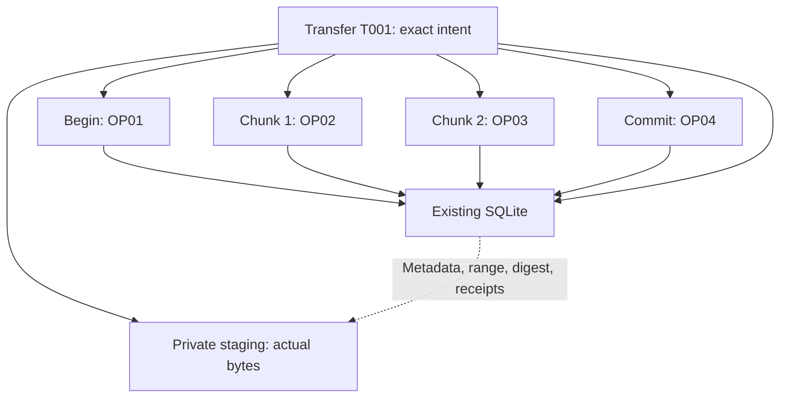

Database stores normalized intent, stage identity, expected size/digest, ranges, quota reservation and references to original Operations. The actual bytes stay in private bounded files, not SQLite, event logs or chat.

### 6.2 Worked recovery example

Ten chunks, six confirmed. The connection breaks during chunk seven. On continuation, authenticate, recover original transfer/receipt and verify exact stage provenance plus recorded bytes. Do not resend all ten or assume chunk seven never arrived.

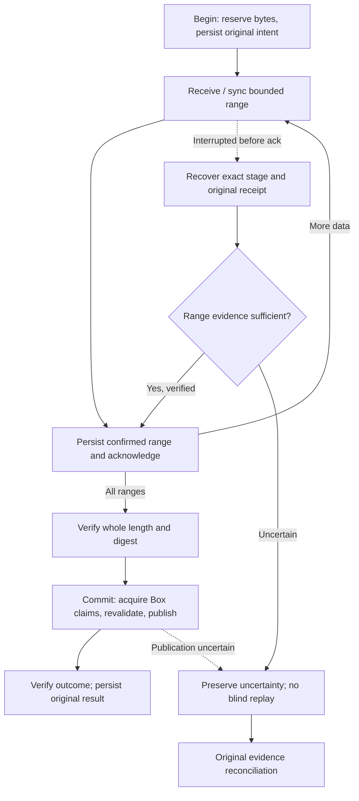

In a proven private stage, reconcile matching unacknowledged bytes before acknowledging them; reject conflicts. If the final path exists with the same digest, that alone does not establish it was produced by the original Operation. Never adopt, delete, or blindly replay an ambiguous final effect. Keep UNKNOWN and independently reconcile as existing contract requires. If current Actor no longer has access, do not disclose private bytes or begin another native effect; revocation does not undo already dispatched effects.

### 6.3 Avoid locking a Box throughout client upload

During client-to-controller staging, reserve bounded storage but do not hold the Box mutation claim while waiting for the next client request. During commit, acquire existing affected Box claims, revalidate identity/state and apply only supported native semantics. A direct native copy has one admitted copy job holding affected claims for its bounded execution.

R0 verified synthetic local process-exit windows around data sync/journal acknowledgment and local link publication, plus a distinct native controlled reconnect. Local inode evidence and sync semantics cannot be assumed available via SFTP. The native 7.7 witness did not advertise fsync. Distinguish durable controller staging, verified Guest readback and power-loss durability.

### 6.4 Proposed schema relationship

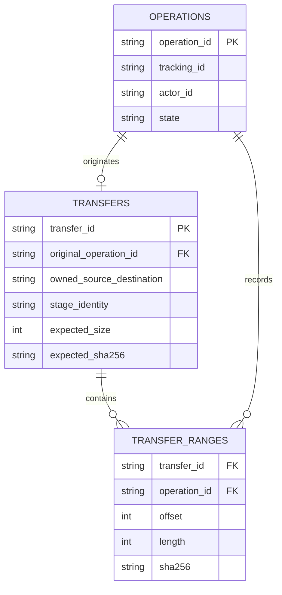

Concept only, not SQL DDL or complete operation-to-transfer association model; begin/commit/abort and item-level manifest linkage must be resolved in implementation design. Existing Schema 7 has strict DDL and no transfer record. A minimal next schema (possibly 8) is proposed subject to owner approval, including installer/Doctor/recovery, private stage quota and expiry, retirement and uninstall. Do not automatically migrate or reset existing Schema 7, erase unresolved originals, or introduce an independent journal/database. Existing fresh-only compatibility policy remains until explicitly revised.

## 7. Direction F — existing-file edits and safe publication

### 7.1 Why a hash check is not CAS

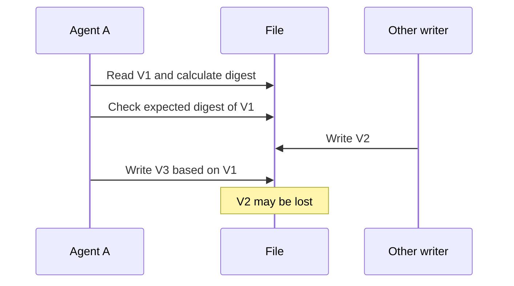

An expected hash can detect an earlier change but not a change between verification and mutation. A BoxWeave internal lock serializes its own writers, not arbitrary Guest processes or other native writers. Stopping the Guest removes ordinary running processes but does not establish exclusive access from all other actors. Strict CAS requires atomic conditional mutation, not two separately successful requests.

| Semantics | Guarantee | R0 evidence |
| --- | --- | --- |
| Exclusive create | Existing path not overwritten | Observed native O_EXCL collision refusal |
| Atomic publish | Complete new bytes become visible together | Candidate only |
| Conditional update/delete | A conflicting revision cannot be overwritten/deleted | Unproven; unsupported |
| Append | Add bytes rather than overwrite | Failed exact witness; deferred |

Ordinary and Posix Rename replaced existing targets. Hardlink refused existing target on the tested backend, but creates aliases and needs separate stage provenance, path, cleanup and recovery proofs before product use. Exclusive create may expose partial bytes on interruption; retain UNKNOWN when effect is ambiguous. Native append returned success but overwrote eight prefix bytes without growing the file, independently verified. Do not substitute seek-to-end and claim atomic or retry-safe append.

### 7.2 Three possible editing levels

1. Read-only preview: parse a bounded edit, resolve its target and exact match, generate diff and report ambiguity without changing content.
2. Explicit alternative non-CAS editing: future research candidate only, separate owner decision, scoped workspace and truthful concurrency/effect contract. It is not an implementation of strict conditional update and does not change existing guarantees.
3. Strict conditional update: only after evidence establishes the point-of-use guarantee. Keep conditional replace/delete unsupported otherwise.

Do not block discovery/read/copy/new-file creation on this unresolved question. However, lack of an existing-file edit is a genuine product limitation: an Agent doing normal code maintenance may still need explicitly requested ordinary Guest Exec until an approved editing contract is implemented. The file Tool itself must not silently substitute Exec.

## 8. Direction G — actual agent work and BDH

Example: an agent takes over a PR in an owned development Box, locates implementation, reads relevant sections, plans a change, creates a new test, runs tests and copies a build artifact into an owned test Box.

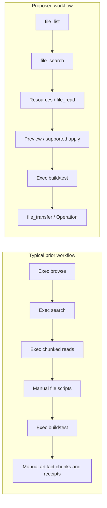

The objective is to reduce model-mediated bytes, repetitive calls, manual assembly and verification effort without hiding failures or weakening checks. Direct copy bypasses model bytes; Tools-only upload may still require substantial calls. The previous BDH 80 KiB transfer used 52 calls (18 core, 34 supporting); subsequent experiments used 73/250/81 calls and did not prove independent efficiency gains. Do not use those distinct trials as a controlled causal comparison. P6 should measure matched tasks, success and failure, actual calls including polling/retries, bytes, time, intervention and recovery. Report unavailable metrics honestly.

| Responsibility | Intended owner |
| --- | --- |
| Byte streaming, chunks, assembly, digest and verified range progress | Native Filesystem |
| Durable mutation receipt, resource coordination, recovery | Existing Runtime |
| Development checkpoint, CI observation, learning and plans | BDH / Agent |
| Architecture choices, coding and judgment | Agent |
| Build, test and program execution | Compute / Exec |

Keep BDH helpers until new product behavior is accepted; no deletion or redesign of BDH in this workstream.

## 9. Dependency graph and delivery gates

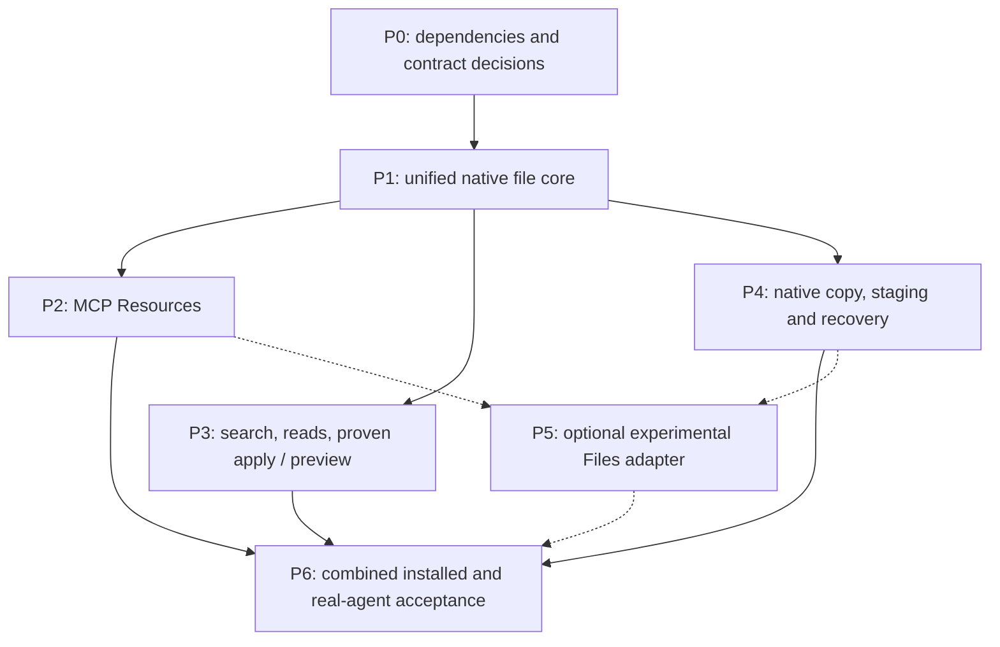

P2/P3 and P4 preparation may proceed independently after shared contracts are settled, respecting implementation conflicts, ownership and staged integration gates. P5 is optional and must not block P6 acceptance of supported baseline scope. P0 resolves exact dependencies and catalog/schema decisions. Each P uses material R0–R5 steps; reuse the consolidated CI and existing tests rather than adding a workflow for each experiment.

## 10. Evidence and owner decisions

| Topic | R0 status / delivery condition |
| --- | --- |
| Incus 7.7 and SDK build | Native package, standalone SDK and exact-base product source compatibility observed |
| Online/offline and direct copy | Basic default-Project native evidence positive |
| Resources | Synthetic HTTP SDK positive; real external client unverified |
| Staging/resume | Local process-exit and controlled native reconnect positive; integrated persistence/fault recovery unverified |
| Existing-file edits | Preview candidate; strict CAS unsupported |
| Append | Negative result retained; deferred |
| Restricted nonroot Project | Probe upload blocked by platform safety check; no native result or alternate route |
| Files Extension | Experimental and optional |
| Full product | Installed restricted acceptance, CI, quotas, disk-full, cancellation, retirement, real Agent efficacy remain separate gates |

Owner decisions before contract changes: approve the 25-tool catalog or retain 23; approve a minimal new persisted schema and compatibility policy or stage transfer persistence separately; decide whether to research a clearly labeled alternative existing-file editing contract. Initial limits, API names/modes, URI details and staging relationships are design proposals to be frozen with focused evidence. No production dependency change, feature enablement, merge, or release follows from this document alone.
