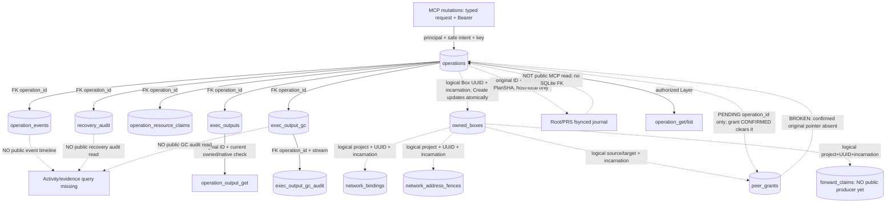

# BoxWeave v1 — MCP Tool → SQLite / Events / Logs Lineage: Source Audit and Implementation Design

**Date:** 2026-11-19 · **Status:** SOURCE-ONLY DESIGN COMPLETE; IMPLEMENTATION NOT STARTED · **Scope:** Draft PR #153, `feat/v1-s4-runtime-integration-20261116`, pinned source `f2c0b5afaecd0d1922d5957c8f9d24e67ad957d7`. Do not treat this report as a live SDK/SQLite fixture/native acceptance run.

**Decision requested before implementation:** approve or decline one additional public `box_activity_get` Tool (potential 18th *current* public Tool, not a claim about the post-S4 final total), its three views, and any Schema v5 clean-rebuild impact. A1 is already source/SDK-verified; A2 real client interrupted recovery and S5 TC-015/016 remain deferred. **This document changes no production code, schema, service, resource, or Tool contract.**

## 1. Source of truth, enumeration, and verdict

Read in order: [audit-plan](https://github.com/vanishs/boxweave/blob/f2c0b5afaecd0d1922d5957c8f9d24e67ad957d7/docs/development/V1_MCP_TO_DB_LOG_LINEAGE_AUDIT_PLAN_2026-11-19.md#L1-L90), [ux-design](https://github.com/vanishs/boxweave/blob/f2c0b5afaecd0d1922d5957c8f9d24e67ad957d7/docs/development/V1_MCP_AGENT_UX_AND_ACTIVITY_DESIGN_2026-11-18.md#L1-L25), [agents](https://github.com/vanishs/boxweave/blob/f2c0b5afaecd0d1922d5957c8f9d24e67ad957d7/AGENTS.md#L1-L90), actual registered handlers [server](https://github.com/vanishs/boxweave/blob/f2c0b5afaecd0d1922d5957c8f9d24e67ad957d7/internal/control/server.go#L123-L173) and [SDK-test](https://github.com/vanishs/boxweave/blob/f2c0b5afaecd0d1922d5957c8f9d24e67ad957d7/internal/control/server_test.go#L111-L175). The *source* catalog and exact 17-name official-SDK assertion agree; the SDK test was **read, not re-executed** in this investigation. Registration: 1 host, 2 original-operation reads, 8 Box, 1 Peer, 3 Guest file, 2 output/cancel = **17 Tools**, 8 read + 9 mutate. There is **no public Forward or box_wait_ready** registration at this HEAD; `forward_claims` is schema groundwork, not a proved MCP producer. S4-B4–B6 and S4-C remain PLANNED/NOT_IMPLEMENTED; no acceptance is inferred from prior CI.

**Verdict:** already durable for all nine *admitted* mutation originals; notably actor-scoped idempotency, work/agent labels, safe intents, original `operation_id`, original `tracking_id`, resource claims, state transitions and most native receipts. **Not fully recoverable** for (a) current `peer_grants.CONFIRMED` → verified original link, intentionally cleared during finalization; (b) cross-Box/cross-time actionable discovery; (c) the underlying event/recovery/GC narrative via public MCP; (d) correlation of inbound middleware request logs with `operations.request_id`. Some missing data is explicitly *not meant to exist*: pure reads, rejected-before-admission calls, secrets/raw commands, file bytes, future/unknown native effects, Agent goals, and host-local Root journals.

**Evidence terminology:** `SOURCE_CONFIRMED` = direct producer/reader SQL and typed handler path located, **not** runtime-pass; `PARTIAL` = some links or readbacks missing; `MISSING` = a necessary deterministic producer/link/read path does not exist; `N/A` = intentionally unjournaled read/pre-admission refusal; `PLANNED` = unregistered future feature. All current observations below are SOURCE_ONLY; **no new SDK, disposable SQLite EXPLAIN, Go test, or native test was run**.

## 2. Common field-lineage rules (apply to every row in the per-Tool matrix)

| Field / dimension | Producer and persistence | Reply / authorized read path | Trust boundary / caveat |
|---|---|---|---|
| `actor_id` / `token_id` / `layer` | Bearer verifier → SDK TokenInfo → `requestPrincipal`; for mutations `Admission` → `operations`; token maps to stable OAuth Grant actor or manual-token actor | Current Layer-bound `GetScopedOperation` / `ListOperations`, not by arbitrary agent label; query results deliberately omit raw token identities | OAuth refresh creates a different TokenID, same Grant Actor; revoke and expiration rechecked before private reads. [principal](https://github.com/vanishs/boxweave/blob/f2c0b5afaecd0d1922d5957c8f9d24e67ad957d7/internal/control/operation_tools.go#L12-L37), [token](https://github.com/vanishs/boxweave/blob/f2c0b5afaecd0d1922d5957c8f9d24e67ad957d7/internal/state/store.go#L409-L507), [oauth](https://github.com/vanishs/boxweave/blob/f2c0b5afaecd0d1922d5957c8f9d24e67ad957d7/internal/state/oauth.go#L416-L535) |
| `idempotency_key` | Client only for 9 mutations; hashed into `key_digest`, unique `(layer,actor_id,key_digest)` | Exact same actor/key/intention replays original receipt; another actor's key is not transferable | Raw key is not stored; immutable `safe_intent`/resource-claim digest detects contradictory retry; optional labels are not part of intent digest. [admit](https://github.com/vanishs/boxweave/blob/f2c0b5afaecd0d1922d5957c8f9d24e67ad957d7/internal/state/store.go#L510-L553), [claims](https://github.com/vanishs/boxweave/blob/f2c0b5afaecd0d1922d5957c8f9d24e67ad957d7/internal/state/network_claims.go#L12-L66) |
| `work_ref` / `agent_ref` | Optional input fields or consistent `_meta.io.boxweave.*` on mutation requests → admission → operation columns | `operation_list` filters (only after Layer auth); receipts repeat original labels | Client-supplied hints, not an Agent identity, authorization, lock, or task checkpoint. Empty labels are legitimate. [labels](https://github.com/vanishs/boxweave/blob/f2c0b5afaecd0d1922d5957c8f9d24e67ad957d7/internal/control/box_tools.go#L108-L135), [query](https://github.com/vanishs/boxweave/blob/f2c0b5afaecd0d1922d5957c8f9d24e67ad957d7/internal/state/operation_query.go#L163-L185) |
| `operation_id` / `tracking_id` | `Store.Admit` generates two original random IDs, persists both; original receipt returns both | `operation_get/list` return original IDs; `operation_get` itself and other read Tools mint a separate ephemeral read-call `tracking_id` | A read-call tracking ID is **not** an original operation ID or a durable call journal. [admit2](https://github.com/vanishs/boxweave/blob/f2c0b5afaecd0d1922d5957c8f9d24e67ad957d7/internal/state/store.go#L690-L715), [read](https://github.com/vanishs/boxweave/blob/f2c0b5afaecd0d1922d5957c8f9d24e67ad957d7/internal/control/operation_tools.go#L88-L165) |
| `request_id` | `admitNative` and Peer allocate an internal random value; `Store.Admit` inserts `operations.request_id` | **Not** in public `Receipt`, `operation_get/list` selections or the current MCP middleware log | Internal durable datum, **not** an existing bridge from inbound `mcp_request` to Operation; avoid claiming otherwise. [admitnative](https://github.com/vanishs/boxweave/blob/f2c0b5afaecd0d1922d5957c8f9d24e67ad957d7/internal/control/box_tools.go#L177-L203), [peer](https://github.com/vanishs/boxweave/blob/f2c0b5afaecd0d1922d5957c8f9d24e67ad957d7/internal/control/peer_tools.go#L77-L99), [middleware](https://github.com/vanishs/boxweave/blob/f2c0b5afaecd0d1922d5957c8f9d24e67ad957d7/internal/control/server.go#L131-L150) |
| `native_operation_id` | Worker records Incus receipt through `NativeAck`/`transition` when an Incus asynchronous ID exists; unknown-with-receipt paths retain it | Exposed in `Receipt`/`operation_get/list` if reliably captured | May legitimately be empty before native dispatch, after a no-op, synchronous SFTP, cancellation, or Peer Root/PRS. Error/timeout without native ACK cannot be guessed. [worker](https://github.com/vanishs/boxweave/blob/f2c0b5afaecd0d1922d5957c8f9d24e67ad957d7/internal/state/worker.go#L56-L154), [transition](https://github.com/vanishs/boxweave/blob/f2c0b5afaecd0d1922d5957c8f9d24e67ad957d7/internal/state/store.go#L728-L825) |
| `box_uuid` / `incarnation` / resource scope | Create starts with `resource_key=box:<name>` and blank UUID; verified creation atomically writes exact UUID, incarnation (currently native UUID), and ownership row. Other owned mutations use exact UUID+incarnation; Peer has source plus additional target claims. | Receipt contains primary Box UUID/incarnation; target Peer identity recoverable through validated safe intent/claims, not as a second Receipt field | Do not merge same-name/same-IP re-creations; unresolved Create lacking UUID must remain discoverable by its **name resource key**. [create](https://github.com/vanishs/boxweave/blob/f2c0b5afaecd0d1922d5957c8f9d24e67ad957d7/internal/state/lifecycle.go#L277-L370), [peerclaims](https://github.com/vanishs/boxweave/blob/f2c0b5afaecd0d1922d5957c8f9d24e67ad957d7/internal/control/peer_tools.go#L67-L99) |
| Event / recovery / Exec / network refs | `operation_events` and `recovery_audit` reference Operation; `exec_outputs`, `exec_output_gc` and its audit use original Operation; network rows use scoped UUID/incarnation but not always a checked Operation FK | Today only final summary/`operation_output_get` are public; other evidence requires new read-only Store projection | Do not expose raw safe intents, guest output paths, raw file content, tokens, root journal, or reviewer internals. [ddl](https://github.com/vanishs/boxweave/blob/f2c0b5afaecd0d1922d5957c8f9d24e67ad957d7/internal/state/store.go#L29-L75), [output](https://github.com/vanishs/boxweave/blob/f2c0b5afaecd0d1922d5957c8f9d24e67ad957d7/internal/control/operation_output_cancel.go#L48-L136) |
| Log facts | Middleware logs method (usually `tools/call`), 4-byte hash prefix of Actor, elapsed ms and coarse outcome | No authorized public host-log search Tool; logs may rotate | No Tool name, request ID, original Operation ID, parameters, or durable consistency with SQLite in that middleware record. [middleware](https://github.com/vanishs/boxweave/blob/f2c0b5afaecd0d1922d5957c8f9d24e67ad957d7/internal/control/server.go#L131-L150) |

**Failure path invariants:** SDK unknown-field validation, missing principal, invalid input, unsupported file replace/delete, identity/preflight/pinned network refusals, and failed `Store.Admit` checks can all occur **before an original is inserted**. Do not fabricate a historical Operation from them. Once admitted, `operation_events` begins at ADMITTED; `Claim` token-rechecks; ambiguous effects become retained UNKNOWN; process recovery marks claimed in-flight effects UNKNOWN but unclaimed ADMITTED as FAILED; no blind redispatch. [strict](https://github.com/vanishs/boxweave/blob/f2c0b5afaecd0d1922d5957c8f9d24e67ad957d7/internal/control/strict_tool.go#L29-L57), [refusal](https://github.com/vanishs/boxweave/blob/f2c0b5afaecd0d1922d5957c8f9d24e67ad957d7/internal/control/file_tools.go#L130-L151), [admission-locks](https://github.com/vanishs/boxweave/blob/f2c0b5afaecd0d1922d5957c8f9d24e67ad957d7/internal/state/store.go#L558-L715), [restart](https://github.com/vanishs/boxweave/blob/f2c0b5afaecd0d1922d5957c8f9d24e67ad957d7/internal/state/store.go#L827-L882).

## 3. Complete per-public-Tool MCP → Control → Native/State → DB/events/log → reply → Agent matrix

**Key to compact cells:** `P` = request principal (ActorID/TokenID/Layer) verified, mutation persists all three; `L` = optional work/agent label via input/metadata; `K` = Actor-scoped idempotency key hash; `O` = original operation ID/tracking ID and event lifecycle; `N` = native ID if asynchronous Incus receipt observed; `B` = exact owned Box UUID/incarnation; `C` = resource claim; `T` = fresh read tracking ID, not persisted. All routes use the same limited middleware log (not a per-Tool durable audit). `Readback` assumes a *currently valid, currently scoped credential*, not possession of a `work_ref` alone.

| Public Tool | R/M · typed input / source | Inbound→Control→State/Native; stored keys/relations | Result and currently authorized readback | Refusal, UNKNOWN, broken or intentionally missing link | Status |
|---|---|---|---|---|---|
| **host_status** | R; empty object [host](https://github.com/vanishs/boxweave/blob/f2c0b5afaecd0d1922d5957c8f9d24e67ad957d7/internal/control/server.go#L152-L167) | P → Store schema + Native Status; **no SQLite call row**, T only | Build/readiness/status with T. Reinvoke to observe *current* host status | Not Operation evidence; no durable input/request log, so prior invocation cannot be restored | **N/A** (intended) |
| **box_list** | R; `limit,cursor` [box-list](https://github.com/vanishs/boxweave/blob/f2c0b5afaecd0d1922d5957c8f9d24e67ad957d7/internal/control/box_tools.go#L53-L62), [box-list2](https://github.com/vanishs/boxweave/blob/f2c0b5afaecd0d1922d5957c8f9d24e67ad957d7/internal/control/box_tools.go#L456-L481) | P → `owned_boxes` scoped listing → exact Native.GetExactBox for each UUID; T | Paginated current owned BoxState; use UUID then `box_get` or `operation_list` | No list/read history, no operation event, no stable cross-request snapshot of Native observations; no promise of previous inventory | **N/A**, snapshot |
| **box_get** | R; `box_id` [box-get](https://github.com/vanishs/boxweave/blob/f2c0b5afaecd0d1922d5957c8f9d24e67ad957d7/internal/control/box_tools.go#L49-L51), [box-get2](https://github.com/vanishs/boxweave/blob/f2c0b5afaecd0d1922d5957c8f9d24e67ad957d7/internal/control/box_tools.go#L483-L504) | P + B → `OwnedBox` then exact Native.GetExactBox; T | Current BoxState, not a timeline; operations may be searched separately by Layer (not box filter) | Running != Guest readiness; no read journal, no direct current-status→particular operation attribution | **N/A**, observed snapshot |
| **box_create** | M; name, image/typed options, size, start, K, L [box-create](https://github.com/vanishs/boxweave/blob/f2c0b5afaecd0d1922d5957c8f9d24e67ad957d7/internal/control/box_tools.go#L34-L47), [box-create2](https://github.com/vanishs/boxweave/blob/f2c0b5afaecd0d1922d5957c8f9d24e67ad957d7/internal/control/box_tools.go#L347-L454) | P,K,L,O,C(name lock), `safe_intent`; after native effect N; on verified create write `owned_boxes` and B + event **atomically** [create-commit](https://github.com/vanishs/boxweave/blob/f2c0b5afaecd0d1922d5957c8f9d24e67ad957d7/internal/state/lifecycle.go#L324-L370) | Original Receipt immediately; then `operation_get/list`; current Box via `box_get` after known UUID | Before UUID is observed only `box:<name>` lock connects it; failed native create/404/failed-start residue must not be inferred as success. Input-validation denial unjournaled | **SOURCE_CONFIRMED**, no new input needed; Activity must search resource name |
| **box_start** | M; `box_id,K,L` [box-operate](https://github.com/vanishs/boxweave/blob/f2c0b5afaecd0d1922d5957c8f9d24e67ad957d7/internal/control/box_tools.go#L69-L74), [box-power](https://github.com/vanishs/boxweave/blob/f2c0b5afaecd0d1922d5957c8f9d24e67ad957d7/internal/control/box_tools.go#L506-L576) | P,K,L,O,B,C(name lock); Native `SetPower` N or proved no-op; state/events | Original Receipt; `operation_get/list`; current native via `box_get` | No-op may have no N, yet verified SUCCEEDED. Native snapshot may later change independently; admission locks protect in-flight / UNKNOWN | **SOURCE_CONFIRMED** |
| **box_stop** | M; `box_id,K,L`, same shared handler [box-power](https://github.com/vanishs/boxweave/blob/f2c0b5afaecd0d1922d5957c8f9d24e67ad957d7/internal/control/box_tools.go#L506-L576) | P,K,L,O,B,C(name lock), N if actually dispatched; event transitions | Receipt/readback same as start | No-op without N is legitimate; stopping is not proof of guest workflow checkpoint or durable file state | **SOURCE_CONFIRMED** |
| **box_update** | M; `box_id`, presence-aware typed options, K,L [box-update-input](https://github.com/vanishs/boxweave/blob/f2c0b5afaecd0d1922d5957c8f9d24e67ad957d7/internal/control/box_tools.go#L76-L87), [box-update](https://github.com/vanishs/boxweave/blob/f2c0b5afaecd0d1922d5957c8f9d24e67ad957d7/internal/control/box_tools.go#L578-L648) | P,K,L,O,B,C(name lock), sanitized changed options; Incus N; verified postread + events | Original Receipt; `operation_get/list` plus `box_get` current shape | Invalid/no-change/unsafe-native option may reject pre-admission; current config may be altered by later operations | **SOURCE_CONFIRMED** |
| **box_delete** | M; `box_id,K,L` [box-delete](https://github.com/vanishs/boxweave/blob/f2c0b5afaecd0d1922d5957c8f9d24e67ad957d7/internal/control/box_tools.go#L649-L699) | P,K,L,O,B,C; native N; verifies exact absence, then `owned_boxes.deleted_by_operation_id` tombstone + original success event in one tx [delete-commit](https://github.com/vanishs/boxweave/blob/f2c0b5afaecd0d1922d5957c8f9d24e67ad957d7/internal/state/lifecycle.go#L373-L421) | Original Receipt/readback retained after Box deletion | `box_get` no longer retrieves deleted Box, so historical navigation must use original operation + tombstone; dependent peer/fence/GC locks deny without new original | **SOURCE_CONFIRMED** |
| **box_exec** | M; `box_id,argv,cwd,uid,gid,env,timeout_ms,K,L` [exec-input](https://github.com/vanishs/boxweave/blob/f2c0b5afaecd0d1922d5957c8f9d24e67ad957d7/internal/control/box_tools.go#L89-L100), [exec-mutate](https://github.com/vanishs/boxweave/blob/f2c0b5afaecd0d1922d5957c8f9d24e67ad957d7/internal/control/box_tools.go#L700-L786) | P,K,L,O,B,C; **only** command digest and timeout in `safe_intent`, not raw argv/env; native N; exit code + output *paths* stored with final event atomically [exec-commit](https://github.com/vanishs/boxweave/blob/f2c0b5afaecd0d1922d5957c8f9d24e67ad957d7/internal/state/lifecycle.go#L164-L230) | Receipt → `operation_get` → `operation_output_get` for bounded stdout/stderr and Guest exit | `SUCCEEDED` means native execution recorded, **not** exit 0. Output may expire/be absent/truncated, and deleted/missing owned Box can prevent native output read | **SOURCE_CONFIRMED / PARTIAL** for long-lived output |
| **box_peer_set** | M; `source_box_id,target_box_id,allow,K,L` [peer-input](https://github.com/vanishs/boxweave/blob/f2c0b5afaecd0d1922d5957c8f9d24e67ad957d7/internal/control/peer_tools.go#L13-L20), [peer](https://github.com/vanishs/boxweave/blob/f2c0b5afaecd0d1922d5957c8f9d24e67ad957d7/internal/control/peer_tools.go#L22-L101) | P,K,L,O,B(source), C(shared ACL + both Box UUIDs); safe intent stores **both UUID/incarnations**, Project/Bridge/ACL/direction. `Store.Admit` only; separate host-approved stage/Root performs actual effect [peer-stage](https://github.com/vanishs/boxweave/blob/f2c0b5afaecd0d1922d5957c8f9d24e67ad957d7/internal/state/network_peer_grant_stage.go#L17-L178), [root-call](https://github.com/vanishs/boxweave/blob/f2c0b5afaecd0d1922d5957c8f9d24e67ad957d7/internal/control/peer_root.go#L11-L121) | Original Receipt → `operation_get/list`; host-local Root journal by original ID, **not** public MCP | `peer_grants.operation_id` set at PENDING but **cleared on CONFIRMED grant** [peer-confirm](https://github.com/vanishs/boxweave/blob/f2c0b5afaecd0d1922d5957c8f9d24e67ad957d7/internal/state/network_peer_root_grant_worker.go#L11-L65); no deterministic current CONFIRMED→original key. No Incus Native Operation ID for PRS; accepted != kernel-effective | **MISSING** current verified-grant backlink; otherwise PARTIAL |
| **box_file_list** | R; `box_id,path,limit,cursor` [file-in](https://github.com/vanishs/boxweave/blob/f2c0b5afaecd0d1922d5957c8f9d24e67ad957d7/internal/control/file_tools.go#L16-L30), [file-list](https://github.com/vanishs/boxweave/blob/f2c0b5afaecd0d1922d5957c8f9d24e67ad957d7/internal/control/file_tools.go#L61-L92) | P,B → bounded Native Guest SFTP listing, T; no persisted read/evidence row | Entries, cursor, non-snapshot flag; reacquire current content | No historic listing, file-name pagination isn't a consistent snapshot; path may be private | **N/A** (intended) |
| **box_file_read** | R; `box_id,path,offset,length` [file-read-in](https://github.com/vanishs/boxweave/blob/f2c0b5afaecd0d1922d5957c8f9d24e67ad957d7/internal/control/file_tools.go#L32-L49), [file-read](https://github.com/vanishs/boxweave/blob/f2c0b5afaecd0d1922d5957c8f9d24e67ad957d7/internal/control/file_tools.go#L94-L128) | P,B → current SFTP read, T, page hash; **no persistent read/byte audit** | Bounded page/base64 and page SHA; no full-file digest for partial reads | Cannot reconstruct prior read/bytes; never store file content in Activity or logs | **N/A** (intended) |
| **box_file_apply** | M; `box_id,path,mode,content_base64,K,L` [file-write](https://github.com/vanishs/boxweave/blob/f2c0b5afaecd0d1922d5957c8f9d24e67ad957d7/internal/control/file_tools.go#L130-L198) | Only `mode=create`: P,K,L,O,B,C; safe intent contains path, byte count, content SHA-256, **not bytes**; synchronous exclusive SFTP, verified event, no N [file-final](https://github.com/vanishs/boxweave/blob/f2c0b5afaecd0d1922d5957c8f9d24e67ad957d7/internal/state/file_create.go#L13-L95) | Original Receipt → `operation_get/list`; independent later `box_file_read` may check *current* file (not historical proof) | replace/delete UNSUPPORTED **before Admit**. Unexpected/ambiguous file result UNKNOWN, but does not archive file contents or external Guest write history | **SOURCE_CONFIRMED**, constrained evidence |
| **operation_get** | R; `operation_id,wait_ms` [op-get](https://github.com/vanishs/boxweave/blob/f2c0b5afaecd0d1922d5957c8f9d24e67ad957d7/internal/control/operation_tools.go#L51-L61), [op-get2](https://github.com/vanishs/boxweave/blob/f2c0b5afaecd0d1922d5957c8f9d24e67ad957d7/internal/control/operation_tools.go#L88-L140) | P → `GetScopedOperation(layer, requester, id)`; bounded poll, T; final TokenID liveness check | Full **summary Receipt** with original O,N,B,labels,error_class,next_action; its envelope T is **new** | No event sequence, recovery decisions, claims, `request_id`, actor identity or safe intent in public result; waited receipt not proof of task completion | **PARTIAL** evidence detail |
| **operation_list** | R; L filters, `actor_id,action,state,since_ns,until_ns,limit,cursor` [op-list](https://github.com/vanishs/boxweave/blob/f2c0b5afaecd0d1922d5957c8f9d24e67ad957d7/internal/control/operation_tools.go#L63-L78), [op-list2](https://github.com/vanishs/boxweave/blob/f2c0b5afaecd0d1922d5957c8f9d24e67ad957d7/internal/control/operation_tools.go#L142-L165) | P → parameterized same-Layer `ListOperations`, HMAC cursor / admission rowid watermark, T [list-sql](https://github.com/vanishs/boxweave/blob/f2c0b5afaecd0d1922d5957c8f9d24e67ad957d7/internal/state/operation_query.go#L107-L251) | Max 50/page, ascending creation-time original receipt summaries | No `box_uuid`/resource-key filter, no DESC/recent-first mode, no aggregate attention. No labels means paging from oldest; current state filter can shift across pages despite rowid watermark | **PARTIAL**, P1 query gap |
| **operation_output_get** | R; `operation_id,stream,offset,limit` [output](https://github.com/vanishs/boxweave/blob/f2c0b5afaecd0d1922d5957c8f9d24e67ad957d7/internal/control/operation_output_cancel.go#L13-L33), [output-handler](https://github.com/vanishs/boxweave/blob/f2c0b5afaecd0d1922d5957c8f9d24e67ad957d7/internal/control/operation_output_cancel.go#L48-L136) | P → authorized original must be `box_exec` → `exec_outputs`/`exec_output_gc` → verify owned current Box + native recorded stream; T | Bounded 64 KiB/page; `exit_code`, `command_success`, availability, truncation, expired/unknown reason; source content only in this dedicated Tool | Missing/expired/truncated bytes cannot be reconstructed. Proven GC expiry still readable without native path; deleted Box can prevent live output retrieval. **Activity only uses availability/exit summary, not bytes** | **SOURCE_CONFIRMED / PARTIAL** retention |
| **operation_cancel** | M; `target_operation_id,K,L` [cancel-in](https://github.com/vanishs/boxweave/blob/f2c0b5afaecd0d1922d5957c8f9d24e67ad957d7/internal/control/operation_output_cancel.go#L35-L46), [cancel-handler](https://github.com/vanishs/boxweave/blob/f2c0b5afaecd0d1922d5957c8f9d24e67ad957d7/internal/control/operation_output_cancel.go#L139-L185) | P → target Layer-authorized read; **separate** admitted O with `resource_key=cancel:<targetID>` and sanitized target in safe intent; target `CancelQueued` commits CANCELLED/event if still queued [cancel-target](https://github.com/vanishs/boxweave/blob/f2c0b5afaecd0d1922d5957c8f9d24e67ad957d7/internal/state/lifecycle.go#L116-L148) | `cancel_operation` Receipt + `target_operation_id`; both can be fetched independently | Queued-undispatched only, no native ID for cancel; if already dispatched, cancel Operation can fail without reversing original. Relation is logical safe-intent/key, **not a SQL FK** | **SOURCE_CONFIRMED / PARTIAL** evidence join |

**17 rows are exhaustive for this HEAD.** In particular: there is no implicit history for the 8 read Tools, no public Root/PRS Tool, and no publicly registered Forward Tool. Every source-denial before `Admit` is `NOT_JOURNALED_BY_DESIGN` unless a future bounded security-denial audit is separately approved. The nine mutable Tools share the receipt mechanism but do not all create native IDs; demanding one from File, Cancel, Peer would fabricate evidence.

**Untrusted vs trusted columns:** `work_ref/agent_ref` and requested Box name = hints; `actor_id/layer/token_id` = server-authenticated identities; `box_uuid/incarnation` = verified controlled identity; `operation_id` = original durable identity; `native_operation_id` = optional native receipt; `tracking_id` = original vs read-call-specific namespace; `request_id` = internal field, not a public join; Root PlanSHA = host-local reviewed digest, not MCP authorization.

## 4. Source-confirmed association map (solid FK vs logical link vs broken/non-authoritative inference)



**Solid relations:** `operation_events/recovery_audit/operation_resource_claims/exec_outputs/exec_output_gc` → `operations.id` are declared SQLite FKs; `exec_output_gc_audit` has the composite GC FK. `owned_boxes.deleted_by_operation_id`, `peer_grants.operation_id`, `network_address_fences.operation_id` and `forward_claims.operation_id` are TEXT links, **not** declared FKs. Box joins by controlled UUID+incarnation+Layer, never name or IP. The Root per-original journal is a separately durable **host-root domain**, not a publicly available sqlite table: [root-journal](https://github.com/vanishs/boxweave/blob/f2c0b5afaecd0d1922d5957c8f9d24e67ad957d7/internal/install/network_peer_conntrack_operation.go#L15-L65), [root-transport](https://github.com/vanishs/boxweave/blob/f2c0b5afaecd0d1922d5957c8f9d24e67ad957d7/internal/install/native_peer_root_socket.go#L26-L53), [root-private](https://github.com/vanishs/boxweave/blob/f2c0b5afaecd0d1922d5957c8f9d24e67ad957d7/internal/install/network_peer_conntrack_journal.go#L23-L120).

**Authority separation:** operation/event = controller-observed/admitted state; Exec exit = verified Guest process result when present; `network_bindings`/fences/Peer = protected controller ledger (not arbitrary live kernel truth); Root journal = independently fsynced host-local evidence; current `box_get/file_read` = live observations at invocation only; external Git/Checkpoint and Agent intent = outside this product. A `peer_grants.CONFIRMED` SQL row **by itself cannot prove live IPv4/IPv6 packets or current ACL enforcement**.

## 5. Breakage and remediation register

| Priority | Exact lost / hidden datum, root cause | Consequence | Minimal remediation / what NOT to do |
|---|---|---|---|
| **P0** | Current `peer_grants.CONFIRMED` clears staging `operation_id` in `FinalizeRootPeerGrant`; no independent last-verified original pointer [peer-confirm](https://github.com/vanishs/boxweave/blob/f2c0b5afaecd0d1922d5957c8f9d24e67ad957d7/internal/state/network_peer_root_grant_worker.go#L15-L65) | No direct deterministic current-grant→original Operation backlink after successful grant, especially regrant cycles | Prefer **nullable** `peer_grants.last_verified_operation_id REFERENCES operations(id)`, set in the **same terminal commit** for both verified grant and revoke/reconcile; keep existing PENDING `operation_id` semantics unchanged. On old/unlinked rows emit `UNKNOWN_PROVENANCE`, never guess from matching IP/name/time. |
| **P1** | `operation_list` ASC by `created_at`, filters by labels/actor/action/state/time but not Box UUID/resource claim, no recent-first aggregate [list-sql](https://github.com/vanishs/boxweave/blob/f2c0b5afaecd0d1922d5957c8f9d24e67ad957d7/internal/state/operation_query.go#L163-L251) | Agent lacking labels may page through old unrelated work, miss old blocking UNKNOWN if filtering by recent window | Add an *independent bounded Activity read* (subject to Tool approval) that queries recent operations and **old still-effective blockers separately**, using layer/state/claim indexes. Keep current operation-list cursor contract. |
| **P1** | `operation_events`, `recovery_audit` and `exec_output_gc_audit` have no existing public read projection and no declared operation-ID lookup indexes in Schema v4 [ddl](https://github.com/vanishs/boxweave/blob/f2c0b5afaecd0d1922d5957c8f9d24e67ad957d7/internal/state/store.go#L29-L75) | `operation_get` shows the terminal summary but not original transitions, release/GC decisions; naive evidence JOIN scales poorly | Add read-only Store evidence projection; verify actual plan with disposable SQLite `EXPLAIN QUERY PLAN`. Candidate indexes: `operation_events(operation_id,seq)`, `recovery_audit(operation_id,decision,seq)`, `exec_output_gc_audit(operation_id,stream,seq)`. Do not claim these are proven necessary without the EXPLAIN gate. |
| **P1** | `operations.request_id` is stored but never exposed/linked by middleware `mcp_request`; read tracking IDs are ephemeral [admitnative](https://github.com/vanishs/boxweave/blob/f2c0b5afaecd0d1922d5957c8f9d24e67ad957d7/internal/control/box_tools.go#L177-L203), [middleware](https://github.com/vanishs/boxweave/blob/f2c0b5afaecd0d1922d5957c8f9d24e67ad957d7/internal/control/server.go#L131-L150) | Cannot audit one inbound `tools/call` log line back to a specific original from current middleware log alone | SQLite original is sufficient for **authorized recovery**; optional P2 structured *post-admission* event with original op ID, request ID and outcome, no params; do not log actor/token raw or rely on logs for correctness. |
| **P1** | Peer source and target relations live in `safe_intent` and resource claims, while Receipt exposes only source Box UUID; `forward_claims` and fences may have empty/non-FK op IDs | A generic `box_uuid` receipt filter cannot reconstruct the target's peer history or assert a Forward producer | Activity Box view must search exact `operation_resource_claims` plus current scoped network tables; verify Peer intent/type and incarnation. Forward Tool remains PLANNED. Never infer from IP/time/label. |
| **P1** | Admission active-lock logic includes Layer-wide Peer barrier, single-key and multi-claim UNKNOWN/released cases, GC blocked claims, and network dependency rows [admission-locks](https://github.com/vanishs/boxweave/blob/f2c0b5afaecd0d1922d5957c8f9d24e67ad957d7/internal/state/store.go#L558-L689) | A naive recent-24h or simple `UNKNOWN` list incorrectly declares Layer/Box safe | Reuse or test-equate **exact** active-block predicate; always include historical active blockers with explicit coverage flags. Keep Root UNKNOWN non-releasable by generic RELEASED exception. |
| **P2** | Read-only calls and pre-admission denials are intentionally non-journaled; no prior Box GET/file read invocation history | Lost read reply cannot be replayed as a historical read, and no central record of all calls | Declare `NOT_OBSERVED` and perform fresh safe read if authorized; **do not** manufacture Operations or store guest file bytes/commands. |
| **P2** | Exec output is only accessible through a dedicated Tool while output retention/GC and native Box checks can make it unavailable; 7-day retention [gc](https://github.com/vanishs/boxweave/blob/f2c0b5afaecd0d1922d5957c8f9d24e67ad957d7/internal/state/exec_gc.go#L14-L50), [output-handler](https://github.com/vanishs/boxweave/blob/f2c0b5afaecd0d1922d5957c8f9d24e67ad957d7/internal/control/operation_output_cancel.go#L66-L136) | Old Agent cannot restore lost bytes, even if original Operation survives | Activity return exit code, truncation, availability and GC status only; explicit `EXPIRED/UNAVAILABLE/UNKNOWN`, not output content or false command success. |
| **P2** | Current post-admission mutation receipts return directly; `privateReadReply` protects private reads, not a universal outer response hook [private](https://github.com/vanishs/boxweave/blob/f2c0b5afaecd0d1922d5957c8f9d24e67ad957d7/internal/control/private_read.go#L9-L19), [box-create2](https://github.com/vanishs/boxweave/blob/f2c0b5afaecd0d1922d5957c8f9d24e67ad957d7/internal/control/box_tools.go#L347-L454) | A revoke occurring after durable admit but before the response needs an explicit privacy/race test | Test send-boundary credential revocation with durable effect preserved; consider shared receipt return policy **without** cancelling admitted native effects. Do not treat lost reply as lost write. |

## 6. Option assessment and chosen minimum architecture

- **A. Query layer only:** enough for most existing Operations, events, locks and Exec summaries; **insufficient** to restore cleared current Peer verified backlink. Can still deliver an honest degraded projection if SQL change is delayed.
- **B. Targeted end-to-end repair + query:** **recommended**, **not** blanket new Tool inputs: preserve current nine mutation contracts; add one verified Peer terminal backlink in atomic finalizers/reconcile, and safe read models for existing data. No new `work_ref/agent_ref` requirement and no synthetic request/native IDs.
- **C. Minimal Schema DDL/index:** **conditional but likely justified** for verified Peer backlink and evidence-by-operation lookup indexes. Schema v4 has `operations_layer_time` / `operations_state_time`, work/agent, resource and claim indexes; evaluate those first. Fresh Schema v5 only if changed DDL actually lands; update exact schema integrity and reinstall/rebuild notes, fail-closed for old DB; **never** silently drop a running UNKNOWN/root journal.
- **D. Extend `operation_list` instead of a new Tool:** avoids public-surface approval but mixes summary/history/attention/three views into an existing ascending-cursor contract, raises accidental complexity and does not make old hidden evidence directly discoverable. Use a **private Store Activity query first**, then seek explicit Owner approval for public `box_activity_get`. Without approval, retain the private Store APIs/tests and propose later exposure, not a Tool smuggled into the catalog.

### Proposed Authority model

`Activity` is a **read-only derived projection** over existing authoritative SQLite rows, not an event bus, task table, distributed lock, Root accessor, or an Agent memory. It cannot certify external Git HEAD, branch/dirty tree, chat goals, guest task completion, native side effects missing an ACK, current kernel ACL or any unjournaled MCP request. Never perform new native mutations during query.

All three views use **one authorized SQLite read transaction snapshot** for their selected datasets. Apply authenticated Layer before all aggregates; optional Actor ID or label only narrows. Reuse `requestPrincipal()` and `privateReadReply()`, including TokenID recheck just before response. A mutable OAuth Grant Actor remains stable across refresh; a revoked/expired **TokenID cannot receive** the response. Hash or omit Actor in public summaries; do not expose raw token IDs, grant IDs, command digest/raw argv/env, file bytes or paths from native execution logs, full safe_intent, root journal or private reviewer evidence.

**Unified view semantic contracts (proposal; no public Tool yet):**

```json
{
  "tool": "box_activity_get",
  "input": {
    "view": "overview | issues | evidence",
    "box_id": "optional exact owned UUID",
    "operation_id": "required only for evidence",
    "work_ref": "optional untrusted filter",
    "agent_ref": "optional untrusted filter",
    "limit": "1..50 default 20",
    "cursor": "optional authenticated bound cursor"
  },
  "common_output": {
    "tracking_id": "fresh read ID",
    "source": "SQLITE_SNAPSHOT",
    "as_of_ns": 0,
    "scope": "authorized current Layer",
    "coverage": "BOUNDED",
    "truncated": false,
    "attention_complete": false,
    "limitations": ["No automatic native/Guest/Root/Git replay"]
  }
}
```

- **overview**: recent originals, bounded Box IDs/work labels, per-state lower-bound counts (not unbounded lifetime totals); current owned Box snapshot only from SQLite, no native inventory assertion; attention preview. Return only original operation IDs, states, safe action, time, verified UUID/incarnation and permitted evidence pointers.
- **issues**: separately enumerate old **still-effective** UNKNOWN/active operations, Project-wide Peer barriers, multi-resource claims, approved release status, GC review blockers and network dependent `PENDING/UNKNOWN` records. Mirror the entire `Admit`-blocking predicate including special Root cases. Include `block_reason`/`resource_ref`/`operation_id`/`evidence_kind` and `attention_complete=false` when capped. A limited sample must never be presented as proof that no other blockers exist.
- **evidence**: one accessible `operation_id` → original Receipt + bounded ordered `operation_events` + sanitized `recovery_audit` decisions + exact resource claims + relevant ownership/tombstone + Exec exit/GC *metadata only* or Peer relevant scoped metadata, including new verified backlink when known. Root details respond `HOST_LOCAL_REVIEW`, native absent `NATIVE_RECEIPT_UNAVAILABLE`; historical gaps `NOT_RECORDED`. `FAILED`, `UNKNOWN`, nonzero/absent Guest exit and current `CONFIRMED` Peer grant must remain semantically distinct.

**Cursor and cost:** cap each subquery independently; use HMAC-bound cursor scope with per-view+Layer+filter and snapshot/admission watermark where pagination is supported (don't blindly reuse the existing ASC cursor as a DESC cursor). No N+1 unbounded joins; mark consistency holes for external Native reads (none in v1 Activity); report `truncated` and `attention_complete` honestly. Tests must check both the detection rate and intentional omission semantics.

### SQL candidates (not yet applied)

```sql
-- Only if source-to-query fixture EXPLAIN confirms need.
CREATE INDEX operation_events_op_seq
  ON operation_events(operation_id, seq);
CREATE INDEX recovery_audit_op_decision_seq
  ON recovery_audit(operation_id, decision, seq);
CREATE INDEX exec_output_gc_audit_op_stream_seq
  ON exec_output_gc_audit(operation_id, stream, seq);

-- Only with Owner-approved Schema bump, native source fix, exact DDL tests:
-- peer_grants.last_verified_operation_id TEXT NULL REFERENCES operations(id)
-- Written in the same SQLite tx as grant/revoke/reconciled terminal state.
-- Do not change meaning of existing peer_grants.operation_id (pending pointer).
```

`operations_state_time(layer,state,created_at,id)` already supports state-bounded historic UNKNOWN scans and reverse index traversal; `operation_resource_key_state` permits claim lookups; separate active Peer barrier may scan older active states so run representative 100k-row fixture `EXPLAIN QUERY PLAN` before any extra index. `operation_events` and `recovery_audit` are accessed by original ID; verify the cost of exact primary/secondary lookups and use only approved indexes. No unbounded `COUNT(*)` as a falsely complete UI total. Any index/schema change must run exact-definition/schema-fingerprint tests [schema-test](https://github.com/vanishs/boxweave/blob/f2c0b5afaecd0d1922d5957c8f9d24e67ad957d7/internal/state/schema_integrity_test.go#L11-L70).

## 7. Implementation handoff: stages, files, and red/green tests

**Stage 0 — freeze and baseline; no feature changes.**
- Re-read PR HEAD, source/SDK `tools/list` exact inventory, generated MCP JSON Schemas; run focused existing `internal/control/server_test.go` (17 names), `operation_tools_test.go`, `continuity_test.go`, `internal/state/operation_query_test.go`, `schema_integrity_test.go` and Peer/Exec/file tests. Build disposable Schema v4 fixture with multiple Actors in same Layer, foreign Layer, reused names, 30-day-old UNKNOWN, released claim, Root UNKNOWN, overlapping target Peer, output GC states and revoked OAuth.
- Execute `EXPLAIN QUERY PLAN` on real proposed SQL, record SQL/fixture size/index choices; do not use mutable shared DB/host. Failure is a result, not permission to deploy.

**Stage 1 — repair deterministic producer link first (conditional Schema v5).**
- Touch only `internal/state/store.go` (DDL/index/SchemaVersion), `internal/state/network_peer_root_grant_worker.go` (verified grant and reconcile commits), `internal/state/network_peer_root_worker.go`, `internal/state/network_peer_root_recovery.go` (verified revocation/reconcile), related `network_peer_*_test.go` and `schema_integrity_test.go`. Use nullable last_verified_operation_id *in the same tx* as terminal peer change; require exact matching project/UUID/incarnation/original action and protected Root proof. Do not modify Root private journal format/API. **If source/test demonstrates an equivalent trusted persistent backlink already exists, skip this field and document that proof.**
- Red tests: CONFIRMED grant cleared pending pointer cannot be mapped; revoke/regrant must not misattribute previous original; failed/UNKNOWN Root must not write terminal backlink; leaked cross-Layer; concurrent stage/tombstone. Green: exact terminal original survives grant/revoke/reconcile and no changed no-replay/ACL semantics. No update of existing initialized DB without separately approved safe rebuild.

**Stage 2 — private read-only `Activity` Store projection; do not add a public Tool yet.**
- New `internal/state/activity_query.go` and `activity_query_test.go`, possibly small shared *pure* helper for active-claim predicates in `store.go` (keep `Admit` transaction authority untouched); reuse `operation_query.go` auth/cursor conventions, `lifecycle.go` Box/tombstones, `network_audit_ledger.go`, `exec_gc.go`.
- Red tests: old unlabelled UNKNOWN missing after >24h, Root UNKNOWN ignored after generic release, false blocker from RELEASED ordinary claim, target Peer omitted, deleted/recreated name conflated, GC REVIEW_REQUIRED hidden, `operation_events` ordering, same snapshot across concurrent transition. Green: stable scoped bounded results; negative replies state incomplete where incomplete.

**Stage 3 — public MCP API (requires distinct Owner approval).**
- New `internal/control/activity_tools.go` and `activity_tools_test.go`; wire one new registration in `internal/control/server.go` and official SDK tool/safety-schema tests. Typed strict `view` enum and authenticated input; return via `privateReadReply` TokenID recheck. Add one discoverable Description/Instructions hint only after actual Tool exists. Do **not** automatically add `work_ref/agent_ref` to read-only APIs or publish Root/host-log access. If Owner declines, stop at internal Store + evidence plan, **no new Tool**.

**Stage 4 — privacy, security, capacity and acceptance.**
- Validate current Token revocation *during* an expensive Activity read, old/manual vs refreshed OAuth Actor, cross Layer and forged refs/cursors, source-equivalent ACL/Root UNKNOWN/no replay, Guest exit 1 vs original SUCCEEDED, missing/expired/GC output, safe_intent secret redaction, zero-output SQL plans with large unrelated history, intentional pre-Admit denied call absence. Validate explicit limited coverage and native observation uncertainty. Re-run exact-code Go race/quality and native regression only where modified code affects native security; no fake PASS from old CI. Optional safe `slog` improvements are **not required** for the core Activity correctness and must be separately tested as non-authoritative.

**Files likely to change only after decisions:** `internal/state/store.go`, `operation_query.go`, `network_peer_root_{grant_worker,worker,recovery}.go`, new `activity_query{,_test}.go`; `internal/control/server.go`, new `activity_tools{,_test}.go`, `server_test.go` and named existing tests; `docs/design/MCP_TOOLS.md`, `MCP_TOOL_CONTRACTS.md`, `AGENTS.md`, `docs/INDEX.md`, acceptance and deployment/rebuild notes. **No need** to alter every MCP input, all Native adapters or host journaling for v1 Activity. Production schema changes require explicit rebuild warning for controller DB, credentials/OAuth clients, connector setup and disposable test fixtures; never silently reset live Boxes/UNKNOWN/root journals.

## 8. Acceptance and limits of this audit

**Performed:** SOURCE_ONLY inspection of current remote PR HEAD, public registration/typed handlers, Schema v4 DDL/indexes, Admit/Claim/Replay/Worker/Recover, operation reads/cursors, Guest File/Exec/GC, Peer stage/Root finalization/recovery, host private journal and relevant checked-in test cases. Pin every inline source reference to the audit HEAD. **No runtime fixtures, EXPLAIN, new test execution, source changes, public API changes or native effects were performed** by this audit.

**Not proved:** ChatGPT actually consuming MCP Instructions, Agent after network interruption finding and interpreting an original, real SQLite index plan/cost under load, actual per-request log continuity, externally authorized host Root journal read, live Native state, exact final-HEAD release signoff. Do not label these PASS.

**Next developer's first code step:** write a failing **disposable SQLite** regression demonstrating `peer_grants.CONFIRMED` has no verified-original backlink and a matching `Root UNKNOWN` negative case. Then implement the atomic verified backlink *only after* Owner approves the Schema change/rebuild contract. In parallel run the query `EXPLAIN` fixture before accepting any new indexes. The public `box_activity_get` remains a **separate approval gate**, not part of this investigation's implementation permission.

---
*Related contracts:* [lineage audit plan](V1_MCP_TO_DB_LOG_LINEAGE_AUDIT_PLAN_2026-11-19.md) · [Activity UX](V1_MCP_AGENT_UX_AND_ACTIVITY_DESIGN_2026-11-18.md) · [Task Checkpoint boundary](TASK_CHECKPOINT_CONTRACT.md) · [Continuity acceptance](../verification/CONTINUITY_ACCEPTANCE.md).