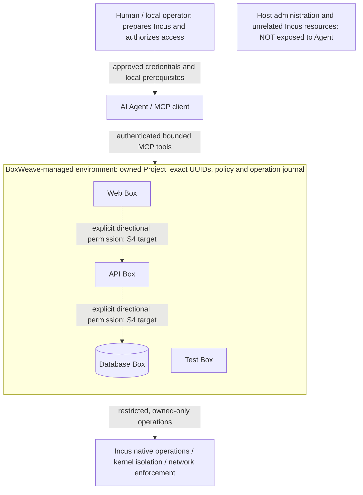

# BoxWeave — secure multi-Box product positioning and landscape notes

> **Discussion archive, not an approved product change.** Observed 2026-11-16 (America/Los_Angeles). This note records an owner-led positioning discussion and a dated comparison of neighboring products. It grants **no** scope, feature, architecture, priority, milestone, implementation, acceptance, release, or merge approval. A later decision must explicitly update the authoritative product boundary and phase plans.
>
> **Pinned baseline:** protected `v1` at [`4a45a80c`](https://github.com/vanishs/boxweave/commit/4a45a80c8de2fb36cde851a10e0f9c80f2f9b300), with 16 registered public MCP tools following signed and merged S3. Concurrent, **unmerged** S4 work is in [PR #153](https://github.com/vanishs/boxweave/pull/153); S4-A has a separately scoped signoff, while S4-B network and S4-C full integration are **not accepted on this pinned baseline**. See [permanent v1 boundary](../decisions/PRODUCT_BOUNDARY.md), [Agent development loop](../product/DEVELOPMENT_LOOP.md), and [S4/S5 allocation](https://github.com/vanishs/boxweave/blob/feat/v1-s4-runtime-integration-20261116/docs/development/S4_S5_EXECUTION_REBALANCE_2026-11-16.md) on the development branch. External product descriptions and URLs are snapshots, not independently verified security/performance guarantees.

## 1. Positioning: the product is the environment, not a single Box

**Working phrase:** **Secure Agent-Programmable Container Environment**.

BoxWeave lets an authorized AI Agent **create, inspect, run and manage multiple owned Linux Boxes and their permitted relationships**, within a bounded environment, **without granting the Agent a generic host shell, host filesystem, or host-wide Incus administrator API**. A Box is the smallest managed unit; the multi-Box environment, its ownership boundary, relationships and verifiable operation lifecycle are the product.

This is **Agent orchestrates Boxes**, not **BoxWeave orchestrates Agents**. The Agent decides business roles and sequences; BoxWeave exposes a small, typed, permission-checked set of safe primitives. BoxWeave is not an application-specific deployment planner, general network administrator or workflow engine.

Illustrative multi-Box target (peer/forward operations are planned S4 behavior, not a claim about merged S3):

The separate host-administration node is intentionally unconnected to the Agent's management path. The four example Box names are workload roles chosen by the Agent, **not** new BoxWeave resource types. Dashed arrows are **conceptual desired peer permissions**, not promises that S4 packet/security acceptance has finished. The host is still a trusted operator-managed substrate. Guest-root Exec inside an owned Box does not confer host-root privilege.

## 2. Differentiating contract (current and planned are distinct)

| Contract | Source maturity at the observation point | Why it matters for an Agent-managed multi-Box environment |
| --- | --- | --- |
| Only BoxWeave-owned Incus Project/Box UUIDs; no arbitrary host/foreign resources | S1–S3 merged; S4-A separately accepted actor/lifecycle refinements in unmerged PR | Prevents agent control of unregistered host infrastructure |
| Typed Box lifecycle, bounded guest Exec, basic guest file operations | S1–S3 merged (16 public tools) | Builds distinct workloads within the same restricted environment |
| Durable admission, reusable idempotency key, original Tracking/Operation IDs, retained output and conservative `UNKNOWN` | S1–S3 merged; S4-A independently strengthened important cases | Prevents uncertain lost replies from becoming blind duplicate native mutations |
| Private inter-Box default deny plus exact **directional** `box_peer_set` and limited TCP/UDP instance-owned forwards | **S4-B design / native investigation and implementation pending**; not 16-tool merged capability | Expresses relationships instead of treating Boxes as a flat list |
| Forward/peer-aware Box Delete and native postcondition reconciliation | **S4-B/C and S5 acceptance still pending** | Avoids orphaned exposure and broken ownership when a Box is removed |
| Independently nestable controller per supported Incus layer | Partially demonstrated in bounded L0–L5/RC labs; **not universal isolation certification** | Enables recursive development/test environments without giving child processes parent Incus credentials |

Critical limitations: the guest-file native SFTP path currently proves exclusive create but **not atomic conditional replace/delete** (unsupported safe refusal). Deep AppArmor/BPF policy administration, hostile sibling isolation, public IPv6 and full S5 release assurance cannot be inferred from working recursion or an upstream SDK probe. Refer to source-pinned test evidence, not marketing claims.

## 3. Adjacent products by kind and their useful lessons

These products overlap at different layers. A product that can create multiple sandboxes is **not automatically** equivalent to directional inter-Box policy or BoxWeave's original native-operation receipt model. `Not documented` below means no **equivalent public product contract was established by this snapshot**, never an assertion of absolute absence.

| Product / evidence | Distinctive features publicly described | Fit with secure multi-Box environment |
| --- | --- | --- |
| [Daytona — linked sandboxes](https://www.daytona.io/docs/sandboxes) | Parent + ephemeral children, same-runner link network, name/ID DNS, **two-way** parent↔child connectivity, cascade delete, snapshots/forks elsewhere in platform | **Closest relation/lifecycle comparison.** Its linked topology is primarily 1:N and bidirectional; BoxWeave targets explicit owned directional peer grants and native dependent cleanup |
| [NVIDIA OpenShell](https://github.com/NVIDIA/OpenShell) ([architecture](https://github.com/NVIDIA/OpenShell/blob/main/docs/about/architecture.mdx)) | Gateway-managed sandbox fleet, enforced filesystem/process/network policy, endpoint-bound credentials, policy change verification | **Closest out-of-Agent security-control philosophy**; much broader sandbox-internal policy surface than v1 BoxWeave's narrow native primitives |
| [Docker Sandboxes — isolation layers](https://docs.docker.com/ai/sandboxes/security/isolation/) | MicroVM per agent with an **independent Docker Engine inside**; can run many containers / Compose without passing through host Docker socket | Strong conceptual analogue of permitting multi-container work **without exposing host Engine**, but composition occurs inside a sandbox VM |
| [Containarium](https://github.com/FootprintAI/Containarium) | Self-hosted persistent boxes, Incus/LXC and Kubernetes backend, SSH, platform MCP, tenant-oriented controls, optional eBPF egress, GPU and model gateway | Closest Incus/agent-infrastructure overlap; intentionally wider platform and tenancy scope |
| [Kubernetes Agent Sandbox](https://github.com/kubernetes-sigs/agent-sandbox) ([threat model](https://github.com/kubernetes-sigs/agent-sandbox/blob/main/docs/security/threat_model.md)) | CRDs Sandbox, Template, Claim, WarmPool; managed NetworkPolicy, controller reconciliation, runtimeClass for gVisor/Kata | Strong declarative ownership/reconciliation reference; Kubernetes-dependent, not a lightweight independent Incus controller |
| [OpenSandbox](https://github.com/opensandbox-group/OpenSandbox) ([Credential Vault](https://github.com/opensandbox-group/OpenSandbox/blob/main/docs/guides/credential-vault.md)) | Docker/Kubernetes unified sandbox APIs, ingress/egress, credential vault, MCP/SDKs, high-density workloads | Broad SDK and reusable policy patterns; sandbox API focus, not BoxWeave's directional owned-Box contract |
| [Agent Substrate](https://github.com/agent-substrate/substrate) ([security](https://github.com/agent-substrate/substrate/blob/main/docs/security/security.md)) | Mutually isolated actors, default-deny lateral network, cryptographic identity, gateway-mediated credentials, pool/multiplexing and hibernation | Strong external policy and actor isolation reference; geared to dense Kubernetes workloads |
| [OpenLegion](https://github.com/openlegion-ai/openlegion) | Isolated agent processes, central mesh for messaging/blackboard permissions, credential/budget governance | **Agent-to-agent workflow security**, not a container relationship engine; source-available licensing has additional restrictions |
| [AgentBox](https://github.com/leciric/agentbox) ([architecture](https://github.com/leciric/agentbox/blob/main/docs/architecture.md)) | Lead Agent, Incus machine per coding agent, branch/worktree, GUI, recording/review, shared project memory | Orchestrates **Agents and development work**, whereas BoxWeave lets **external Agents orchestrate Boxes** |
| [Pixels](https://github.com/deevus/pixels) ([security](https://github.com/deevus/pixels/blob/main/SECURITY.md)) | Incus/TrueNAS backend, checkpoint/clone, dev-tool provisioning, MCP and ephemeral TTL | Small native Incus lifecycle wrapper; explicit current security gaps matter before reuse |
| [Sandstorm](https://github.com/deeplethe/sandstorm) | gVisor / Firecracker, snapshots and multi-tier idle suspension, fleet/node scheduler | High-density lifecycle efficiency rather than peer-relationship enforcement |
| [E2B](https://e2b.dev) | Isolated cloud microVM code execution, developer SDK and sandbox lifecycle | Predominantly an individually allocated sandbox API |
| [Modal Sandboxes](https://modal.com/docs/guide/sandbox-networking) | Cloud-hosted high-scale sandbox compute and networking options | Cloud scale/performance, not this self-hosted Incus management trust boundary |
| [Hostel](https://github.com/compforge/hostel) | Small agent-native sandbox daemon using many lightweight execution beds; OpenSandbox-compatible interface | Lightweight instance multiplexing; different kernel/security/runtime assumptions |

Underlying non-Agent products matter too: [Docker Compose networking](https://docs.docker.com/compose/how-tos/networking/) already offers declarative multi-service graphs; [Incus](https://linuxcontainers.org/incus/docs/main/) already supplies Project, NIC/ACL/proxy and lifecycle primitives. BoxWeave's value is **a restricted Agent-facing contract over those primitives**, not a rewrite of them.

## 4. Product differentiation that can be defended

1. **Environment versus singleton:** the Agent may manage several independently owned Boxes and adjust their safe relationships. The topology and required grants are Agent decisions, not a new BoxWeave business DAG engine.
2. **Host boundary stays external:** no generic Incus admin socket, host-root shell, foreign Box adoption or host file editor appears on the public MCP surface. Human-approved local install and Incus daemon preparation remain operator responsibilities.
3. **Relationships are first-class *semantically*:** directional peer enable/revoke, native host-to-Box port mapping and network-dependent deletion are a coherent bounded capability. This does **not** authorize generic per-port/CIDR ACL editing or DNS/proxy management.
4. **Uncertainty has a first-class status:** original, durable operation receipts with explicit `UNKNOWN` and no speculative redispatch differentiate the *published contract* from a simple create/exec convenience wrapper. Other projects may implement their own retries/reconciliation; do not claim exclusive invention.
5. **Recursive but independent:** each nested layer owns its own Incus, credentials, SQLite and MCP; no product-wide subtree discovery, unified nested inventory or cross-layer management promise.

## 5. Possible evolution directions — *questions*, not a roadmap

**Mainline candidate: preserve a small, trusted multi-Box controller.** Finish the existing S4 network relationship, ACL and dependent-delete gates, then S5 full installed/native security and release evidence before expanding scope.

**Optional interoperability:** if independently useful to more than MCP clients, evaluate separating a reusable domain core and versioned Unix-socket API while preserving the atomic SQLite/worker/native boundary. Existing `control/state/native` are in one Go process today; a second daemon introduces new lost-ACK, identity and version risks. No stdio/socket split is approved in v1.

**Optional convenience:** prebuilt environments, snapshot/clone and TTL may make repeated multi-Box workflows faster, but v1 expressly excludes native snapshots, automatic sleep/wake and a resident task supervisor. Prefer external compositions using existing safe Tools first, then request a separate owner product-boundary decision if evidence supports expansion.

**Optional advanced relationships:** possible future user-level environment/workspace manifests, resource group views or policy summaries **must not** quietly become a generic ACL engine, tenant RBAC framework or orchestration server. Validate whether Agents can already compose the same behavior with existing Box calls and client-owned checkpoints.

**Not a chosen direction:** reimplement AgentBox lead-agent scheduling; Kubernetes fleet management; Containarium-sized multi-tenant platform; provider-hosted high-density Firecracker cloud; entire-host administration. These are distinct product layers and major changes to the permanent v1 non-goals.

## 6. Decision / verification hygiene

- This note is **market and architecture context only**. Authoritative v1 requirements remain [PRODUCT_BOUNDARY](../decisions/PRODUCT_BOUNDARY.md), [MCP_TOOLS](../design/MCP_TOOLS.md), [S4/S5 staged execution](../development/phases/README.md), and exact merged code/independent receipts.
- Do not compare security solely by feature labels or runtime type: Incus container isolation, microVM boundaries, Kubernetes NetworkPolicy, kernel policy sandboxes and host-authorized Incus ACLs have different threat models.
- Every future competitive claim should include a source link, product/version/date and classify `verified`, `publicly documented`, `not documented`, `planned`, or `unsupported`. Never turn silence in another project's README into proof it lacks a feature.
- Avoid stale snapshots: re-read both `v1` HEAD and the active S4/S5 PR head before making new plans or reporting accepted Tools.
- The earlier architecture-only discussion remains separate: [PR #154](https://github.com/vanishs/boxweave/pull/154). Its Socket/worker/recovery questions are **not** implementation authorization either.

**One-sentence working positioning:** *BoxWeave is a self-hosted, secure agent-programmable Linux container environment in which authorized Agents can safely create, connect, run and maintain several owned Boxes, while the host-management boundary and durable operation evidence remain outside the Agent's control.*

## 7. README documentation status (2026-11-16 PT addendum)

The public-facing [README](https://github.com/vanishs/boxweave/blob/v1/README.md) was updated by [PR #156](https://github.com/vanishs/boxweave/pull/156), merged at `22d8021f62d95b5c79dba5c1755582a4da04513f`, to explain the multi-Box positioning, example relationships and current-versus-planned capability boundary. This remains an **archived discussion note** in Draft [PR #155](https://github.com/vanishs/boxweave/pull/155), not a new S4/S5 requirement or product approval.

**Notes-maintenance update:** Git Hooks and GitHub's required docs-only `quality-gate` now follow the same minimal, mechanical formatting policy after [PR #158](https://github.com/vanishs/boxweave/pull/158). This is CI process documentation only, **not** an additional BoxWeave product feature or acceptance claim.

## 8. Follow-up study: 4–12 possible MCP additions (2026-11-17 PT)

> **Status: research and owner preference only; no new Tool or milestone approved.** The owner expressed a preference to **consider Group A (owned multi-Box topology and verification) for future design**. This is permission to *discuss and evaluate*, not an instruction to implement, alter the current v1 boundary, add these Tools to S4/S5, merge this Draft PR, or relax any host/network control. This section is a follow-up to the landscape review above, not an amendment to its original 2026-11-16 pinned observations.
>
> **Current planning distinction:** S3 has 16 merged Tools on the historical pinned baseline. S4-B plans four network Tools; the separately owner-selected [S4-C inspection/readiness plan](https://github.com/vanishs/boxweave/blob/feat/v1-s4-runtime-integration-20261116/docs/development/S4_C_BOX_INSPECTION_READINESS_PLAN_2026-11-16.md) adds \`box_get(detail=true)\` (an extension, not another Tool) and **one** \`box_wait_ready\` Tool. Thus **21 is the selected S4 target, not 21 accepted/merged Tools**. None of the 4–12 ideas below is included in that 21. No duplication of \`box_get\`, \`box_wait_ready\`, \`operation_get\` or the four S4-B Tools is justified merely to reach a Tool count.

### 8.1 Selection criteria and research-source mapping

A useful addition must (a) reinforce **one-layer, owned-only** multi-Box management, (b) expose information/actions that would otherwise require unreliable inference or many coupled calls, (c) preserve actor/UUID/incarnation and original-operation evidence, (d) remain small enough to test with real Incus, and (e) not silently become host administration, an Agent scheduler or a generic networking platform.

| Group | Candidate Tools | Relative benefit | Engineering/security burden | Inspirations and what *not* to copy |
| --- | --- | --- | --- | --- |
| **A. Topology, verification and preflight** | **4** | **Highest fit with multi-Box identity and relation contract** | Medium to high; live packet safety is nontrivial | [Daytona linked sandboxes](https://www.daytona.io/docs/sandboxes) for relationship/lifecycle UX; [Incus networking](https://linuxcontainers.org/incus/docs/main/) for authoritative native objects; S4-B2 failure evidence for multi-layer truth. **Do not copy implicit bidirectional trust.** |
| **B. Declarative environment view/plan** | **5** | High for multi-Box reproducibility | High if apply is introduced | [Docker Compose networking](https://docs.docker.com/compose/how-tos/networking/) for service declarations; [Kubernetes Agent Sandbox](https://github.com/kubernetes-sigs/agent-sandbox) for desired/observed reconciliation. **Do not copy Kubernetes, a resident reconciler or Agent workflow scheduler.** |
| **C. Templates, clone and finite lifetime** | **5** | High repeated-development convenience | Medium for metadata templates; high for clone/expiration | [Pixels](https://github.com/deevus/pixels) for Incus-backed checkpoints/clone and TTL; [Sandstorm](https://github.com/deeplethe/sandstorm) for resource/lifecycle efficiency. **Do not assume storage-driver-independent fast copies or safe automatic deletion.** |
| **D. Constrained egress and credential binding** | **5** | High security potential in a broader runtime product | **Very high: new trusted enforcement subsystem** | [NVIDIA OpenShell](https://github.com/NVIDIA/OpenShell) for policy outside the workload, [OpenSandbox Credential Vault](https://github.com/opensandbox-group/OpenSandbox/blob/main/docs/guides/credential-vault.md) and [Agent Substrate security](https://github.com/agent-substrate/substrate/blob/main/docs/security/security.md) for externally held credentials. **Do not promise enforcement from an MCP setter alone.** |

These are **candidate interface shapes**, not validated native capability mappings. Product descriptions are publicly documented examples, *not independently reproduced comparative security claims*. Where the security model differs (container, microVM, Kubernetes), the mechanism and threat model must be evaluated separately.

### 8.2 Group A — preferred for further *design consideration*

| Candidate | Tentative interface and Agent value | Important limitations |
| --- | --- | --- |
| \`box_topology_get\` | Read a bounded graph of **authorized, exact owned Box UUIDs/incarnations**, directed peer grants, owned forwards and per-edge evidence freshness. Lets an Agent understand its environment in one call. | Only the current controller/layer; never enumerate foreign Incus resources, infer links from a shared IP, or return a purportedly verified link from a stored grant alone. Paginate/bound, redact addresses or configuration as current role permits. |
| \`box_peer_verify\` | Verify a specific directed A→B relationship with a **fixed, bounded, protocol-aware native/guest observation** and return evidence of allowed/denied/indeterminate behavior. Useful after allow/revoke and for troubleshooting. | Not a generic scanner, arbitrary host network probe, custom command executor, packet capture or proof of *all* protocols. A timeout is not automatically an ACL deny; service absence and routing failure are distinguishable. Guest Exec probes require **admin** and independently observed terminal evidence. |
| \`port_forward_verify\` | Read exact owned proxy-device and listener state, and, when safely supported, run an explicitly scoped **local** TCP or application-supported UDP check. Separate configured mapping from actual reachability. | Local loopback verification **does not establish LAN/public reachability**; UDP has no generic connection handshake. No arbitrary remote URL/IP targets, port scans or implicit public bind; independent external LAN/public probes remain separate acceptance witnesses. |
| \`box_change_preview\` | Read-only, authorization-first preflight of a proposed exact-UUID peer/forward/delete change: owned dependents, policy conflicts, potential disruption, current Unknown/partial locks, and capability gaps. Agent can decide whether to proceed. | A preview is **not** a lock, approval, reserved execution plan, or guarantee that later state remains unchanged. Actual mutations still require the existing idempotency/admission checks and independent postconditions. No new generic ACL policy language. |

**Recommended semantic contract for Group A:** return three distinct evidence planes, not a synthetic \`connected=true\`:

1. **Desired:** the durable BoxWeave-owned intent and grant/forward claims (including unresolved \`UNKNOWN\`), tied to exact original actor, UUID/incarnation and current ownership scope.
2. **Native configured/observed:** authorized native Incus ACL, NIC, proxy-device and address readback, native revision/observation time and known gaps. An Incus ACL GET is **not** proof that each relevant kernel NIC successfully applied it.
3. **Runtime verified:** independently witnessed, direction-specific effective packet/connection outcome with probe type, address family, endpoint identity, collection time, confidence/coverage and expiration. No fresh probe means \`NOT_VERIFIED\`, not \`DENIED\`, \`ALLOWED\` or \`SAFE\`.

Do not collapse \`configured_allow\`, \`observed_reachable\` and \`policy_authorized\`: a reachable service might be **unauthorized**, and an authorized path might be unreachable because no service is listening. At minimum model \`EXPECTED_ALLOW\`/\`EXPECTED_DENY\` versus \`OBSERVED_REACHABLE\`/\`OBSERVED_UNREACHABLE\`/\`INDETERMINATE\`, plus a **policy/observation mismatch** classification. Treat stale identity, failed/partial reload, reused IPv4/IPv6 addresses, inconsistent address ownership, missing proof and incompatible topology as **not safely verified**.

**Concrete S4-B2 blocker (not hypothetical).** On disposable native Incus 7.6, [S4-B2 real failed-grant fault run #44034201810](https://github.com/vanishs/boxweave/actions/runs/44034201810) observed an ACL PUT error after an unrelated NIC's host-side veth disappeared. The ACL database/readback showed no A→B ingress grant, yet partial nft kernel rules on A/B permitted **real A→B IPv4 ping**. This was a diagnostic SUCCESS at reproducing a **P0 fail-open**, **not a product PASS**. Source report: [S4-B2 native security evidence](https://github.com/vanishs/boxweave/blob/feat/v1-s4-runtime-integration-20261116/docs/verification/S4_B2_NATIVE_SECURITY_2026-11-16.md). As observed at this research date, **S4_B2_PARTIAL; not accepted, B3 gated**. A future topology tool must not label configured denial as enforced denial while this class of divergence is possible.

**Safety constraints on the verification implementation:** avoid uncontrolled probes, arbitrary Guest argv and private-data logging; cap targets, concurrency, frequency, per-call time and output; use actor-scoped reads and admin authorization when native Guest Exec is used; reject foreign/renamed/recycled identities before and after observation. Verify IPv4 and **enabled** IPv6 separately. Distinguish ICMP from TCP/UDP and newly established flows from existing sessions. Any packet tests involving an authorization change must wait until S4-B2 proves a fail-closed **containment/quiescence** strategy for partial native ACL updates; a read-only probe is not a substitute for that underlying security repair. For \`box_change_preview\`, any eventual mutation rechecks authorization, identity, dependencies and native state at dispatch time.

**Further design questions (not settled here):** Should \`box_topology_get\` combine existing \`box_list\` / \`box_get\` / \`port_forward_list\` information, or is a dedicated bounded query needed to give a consistent scoped graph? Is native packet probing feasible without new privileged host access or unsafe Guest Exec? Which checks meaningfully prove positive connectivity and negative isolation across IPv4/IPv6, not just an unanswered ping? How should probe uncertainty, active sessions, stop/delete races and evidence TTL be exposed to Agents? **A dedicated Tool is only justified where an existing Tool extension or client-side composition cannot safely supply the same semantics.**

### 8.3 Group B — declarative environment view and bounded plan

| Candidate | Proposed purpose | Boundary |
| --- | --- | --- |
| \`environment_validate\` | Validate an optional client-authored environment descriptor: Box roles/resources and directional relationships. | A role is a label, **not** an ownership identity; no generic network ACL/host configuration. |
| \`environment_plan\` | Compare desired descriptor with current *owned* UUIDs and report required changes, affected dependencies and blockers. | Read-only, snapshot-stamped estimate; no secret or foreign inventory, no implicit reservation. |
| \`environment_get\` | Aggregate the caller's environment members and known relation/evidence state. | Must not invent a cross-layer or cross-controller group; may overlap Group A topology. |
| \`environment_export\` | Export a bounded, sanitized, portable description of owned intended configuration. | Do not emit cloud-init secrets, raw sensitive \`InstanceFull\`, tokens, cloneable trust or stale grants. |
| \`environment_apply\` | **Highest-risk optional extension:** admit a bounded sequence of individually authorized resource mutations after a reviewed plan. | Each step keeps original idempotency key, receipt, identity and honest \`FAILED\`/\`PARTIAL\`/\`UNKNOWN\`. No assumed atomicity across SQLite and Incus, speculative retry, global rollback or Agent task scheduler. |

Sample conceptual descriptor, **not an approved wire schema**:

\`\`\`yaml
environment: demo
boxes:
  - role: web
    cpu: 2
  - role: api
    cpu: 2
  - role: db
    cpu: 2
peers:
  - source: web
    target: api
  - source: api
    target: db
\`\`\`

Consider implementing **read/validate/plan only** if Group A proves insufficient for Agent-led composition. \`environment_get\` and \`box_topology_get\` may be redundant; \`environment_apply\` is a substantial product-boundary decision, not a free convenience wrapper. Avoid a resident reconciliation controller and avoid treating client-owned Git/checkpoint metadata as a built-in BoxWeave scheduler.

### 8.4 Group C — templates, cloning, time bounds

| Candidate | Proposed purpose | Specific native/security concerns |
| --- | --- | --- |
| \`box_template_create\` | Save an owned/approved **configuration recipe** (image, CPU, RAM, disk, nesting options). | Do not capture Guest secrets or imply a filesystem snapshot. |
| \`box_template_list\` | List accessible recipes with version/source and validated constraints. | No foreign project/image enumeration or unreviewed privilege flags. |
| \`box_create_from_template\` | Resolve recipe to the existing safe \`box_create\` flow with a fresh UUID and original receipt. | Exact actor/idempotency/immutable image provenance; never inherit peer grants. |
| \`box_clone\` | Clone an owned Guest filesystem or native snapshot into a new identity. | Native clone/snapshot support is storage- and image-dependent. Regenerate identity, MAC/IP/network grants and Guest credentials; check disk budgets and crash consistency. |
| \`box_expiration_set\` | Record an explicitly authorized expiry or cleanup intent for disposable owned Boxes. | Automated expiry is a new deletion controller: unknown operations and dependencies cannot be blindly destroyed. Not synonymous with idle sleep/wake. |

The first three are mostly controlled metadata convenience and might be expressed in client templates without new public Tools. Clone and automatic expiry contradict existing v1 exclusions unless separately approved. [Pixels checkpoints](https://github.com/deevus/pixels) demonstrate an adjacent capability, not a validation that identical semantics will be safe on BoxWeave's supported storage drivers.

### 8.5 Group D — controlled egress and bound credentials

| Candidate | Proposed purpose | Required underlying enforcement |
| --- | --- | --- |
| \`box_egress_policy_get\` | View effective constrained external access grants. | Must distinguish intended policy from network-enforced observation. |
| \`box_egress_policy_set\` | Manage approved destination/service policy for an owned Box. | Strong native default-deny, DNS/IP changes, IPv4/IPv6, bypass prevention and no arbitrary host firewall editor. |
| \`box_credential_binding_create\` | Bind a secret held outside the Guest to a narrowly scoped service/request. | Trusted outbound mediation, safe matching, protected storage and explicit authorization. |
| \`box_credential_binding_list\` | Inspect metadata of active bindings. | Do not return secret values to admin/viewer by default. |
| \`box_credential_binding_revoke\` | Revoke one exact owned binding. | Must account for in-flight requests, credential rotation and proven post-revoke effect. |

An MCP API cannot by itself make a Guest-held credential secret or enforce egress. This direction entails a **new trusted network/credential data plane** plus substantial tests, beyond v1's simple \`internet\` toggle and peer/forward contract. Defer unless the owner consciously changes the product category to include an Agent sandbox security gateway.

### 8.6 Suggested option sizes and decision boundary

| Option | Composition | Research recommendation |
| --- | --- | --- |
| **4 new candidates** | Group **A** (4) | **Preferred design study**. Start with \`box_topology_get\` and \`box_change_preview\` as read-oriented concepts; verify whether they require new MCP Tools. Defer active probing until relevant native safety is established. |
| **8 new candidates** | Group **A** (4) + Group **B**'s four read/validation/planning/export candidates | Broader environment introspection without server-side multi-step mutation. Review overlap between \`environment_get\` and topology rather than mechanically shipping both. |
| **12 new candidates** | Previous 8 + \`environment_apply\` (1) + Group **C**'s first three recipe Tools (3) | A significantly larger future product scope and operational complexity; **not recommended as the immediate step**. |

These counts are **comparison budgets**, not a promise to add that many APIs. Existing Tool enhancement or Agent-side composition is preferred when semantics can be faithfully delivered without a public Tool. No candidate should be counted as an implemented S4 Tool, and the selected 21-Tool S4-C target remains unchanged.

**Required sequence before any Group A implementation approval:**

1. Finish/fix S4-B2 native fail-open and achieve the appropriate S4-B acceptance; preserve the actual partial-fanout, IP-reuse, anti-spoof and restricted-Scriptlet evidence. A graph/readout must not mask unverified enforcement.
2. Complete the already approved S4-C \`box_get(detail)\` and \`box_wait_ready\` scope and independently verify native identity, role permissions and readiness semantics as scheduled; do not duplicate their functionality.
3. Separately compare Group A with existing Tool responses, propose precise minimal JSON schemas, actor/permission policy and **read versus probe** classifications, then benchmark native read/probe overhead on a disposable host. Explicitly decide whether **zero, one or several** new public Tools are justified.
4. Before any Tool is approved, get a new owner scope decision updating [PRODUCT_BOUNDARY](../decisions/PRODUCT_BOUNDARY.md), [MCP_TOOLS](../design/MCP_TOOLS.md), contracts and milestone/acceptance documents; provide negative tests for foreign UUID, reused address, unsupported IPv6, partial ACL fanout, stale evidence, actor revocation and concurrent deletion. Do not open another development PR or modify PR #153 as a consequence of this research note alone.

**Current owner signal:** **Group A should be considered and designed further; it is *not yet* an approved 4-Tool implementation.** The strongest prospective differentiation is **owned multi-Box topology plus honest, per-layer verification evidence**, *not* an expanded Incus administrator API, generic network scanner, Agent scheduler or web-hosting platform.
