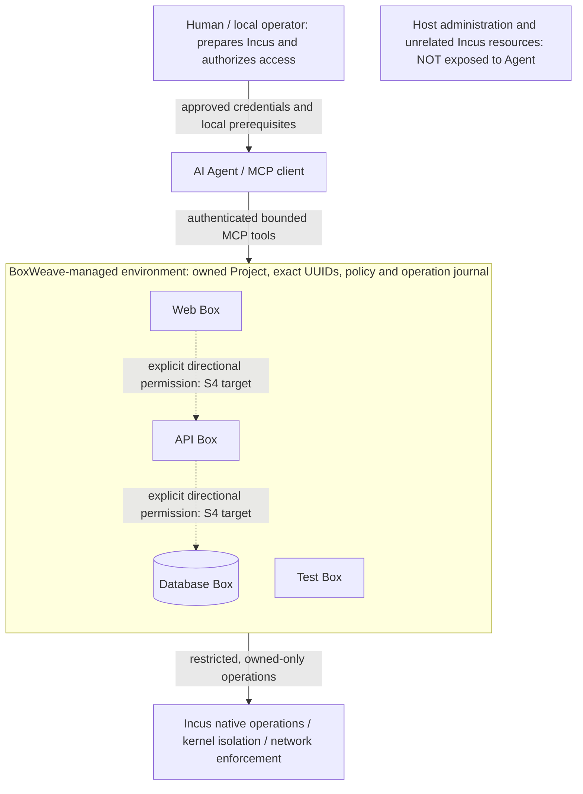

# BoxWeave — secure multi-Box product positioning and landscape notes

> **Discussion archive, not an approved product change.** Observed 2026-11-16 (America/Los_Angeles). This note records an owner-led positioning discussion and a dated comparison of neighboring products. It grants **no** scope, feature, architecture, priority, milestone, implementation, acceptance, release, or merge approval. A later decision must explicitly update the authoritative product boundary and phase plans.
>
> **Pinned baseline:** protected `v1` at [`4a45a80c`](https://github.com/vanishs/boxweave/commit/4a45a80c8de2fb36cde851a10e0f9c80f2f9b300), with 16 registered public MCP tools following signed and merged S3. Concurrent, **unmerged** S4 work is in [PR #153](https://github.com/vanishs/boxweave/pull/153); S4-A has a separately scoped signoff, while S4-B network and S4-C full integration are **not accepted on this pinned baseline**. See [permanent v1 boundary](../decisions/PRODUCT_BOUNDARY.md), [Agent development loop](../product/DEVELOPMENT_LOOP.md), and [S4/S5 allocation](https://github.com/vanishs/boxweave/blob/feat/v1-s4-runtime-integration-20261116/docs/development/S4_S5_EXECUTION_REBALANCE_2026-11-16.md) on the development branch. External product descriptions and URLs are snapshots, not independently verified security/performance guarantees.

## 1. Positioning: the product is the environment, not a single Box

**Working phrase:** **Secure Agent-Programmable Container Environment**.

BoxWeave lets an authorized AI Agent **create, inspect, run and manage multiple owned Linux Boxes and their permitted relationships**, within a bounded environment, **without granting the Agent a generic host shell, host filesystem, or host-wide Incus administrator API**. A Box is the smallest managed unit; the multi-Box environment, its ownership boundary, relationships and verifiable operation lifecycle are the product.

This is **Agent orchestrates Boxes**, not **BoxWeave orchestrates Agents**. The Agent decides business roles and sequences; BoxWeave exposes a small, typed, permission-checked set of safe primitives. BoxWeave is not an application-specific deployment planner, general network administrator or workflow engine.

Illustrative multi-Box target (peer/forward operations are planned S4 behavior, not a claim about merged S3):

The separate host-administration node is intentionally unconnected to the Agent's management path. The four example Box names are workload roles chosen by the Agent, **not** new BoxWeave resource types. Dashed arrows are **conceptual desired peer permissions**, not promises that S4 packet/security acceptance has finished. The host is still a trusted operator-managed substrate. Guest-root Exec inside an owned Box does not confer host-root privilege.

## 2. Differentiating contract (current and planned are distinct)

| Contract | Source maturity at the observation point | Why it matters for an Agent-managed multi-Box environment |
| --- | --- | --- |
| Only BoxWeave-owned Incus Project/Box UUIDs; no arbitrary host/foreign resources | S1–S3 merged; S4-A separately accepted actor/lifecycle refinements in unmerged PR | Prevents agent control of unregistered host infrastructure |
| Typed Box lifecycle, bounded guest Exec, basic guest file operations | S1–S3 merged (16 public tools) | Builds distinct workloads within the same restricted environment |
| Durable admission, reusable idempotency key, original Tracking/Operation IDs, retained output and conservative `UNKNOWN` | S1–S3 merged; S4-A independently strengthened important cases | Prevents uncertain lost replies from becoming blind duplicate native mutations |
| Private inter-Box default deny plus exact **directional** `box_peer_set` and limited TCP/UDP instance-owned forwards | **S4-B design / native investigation and implementation pending**; not 16-tool merged capability | Expresses relationships instead of treating Boxes as a flat list |
| Forward/peer-aware Box Delete and native postcondition reconciliation | **S4-B/C and S5 acceptance still pending** | Avoids orphaned exposure and broken ownership when a Box is removed |
| Independently nestable controller per supported Incus layer | Partially demonstrated in bounded L0–L5/RC labs; **not universal isolation certification** | Enables recursive development/test environments without giving child processes parent Incus credentials |

Critical limitations: the guest-file native SFTP path currently proves exclusive create but **not atomic conditional replace/delete** (unsupported safe refusal). Deep AppArmor/BPF policy administration, hostile sibling isolation, public IPv6 and full S5 release assurance cannot be inferred from working recursion or an upstream SDK probe. Refer to source-pinned test evidence, not marketing claims.

## 3. Adjacent products by kind and their useful lessons

These products overlap at different layers. A product that can create multiple sandboxes is **not automatically** equivalent to directional inter-Box policy or BoxWeave's original native-operation receipt model. `Not documented` below means no **equivalent public product contract was established by this snapshot**, never an assertion of absolute absence.

| Product / evidence | Distinctive features publicly described | Fit with secure multi-Box environment |
| --- | --- | --- |
| [Daytona — linked sandboxes](https://www.daytona.io/docs/sandboxes) | Parent + ephemeral children, same-runner link network, name/ID DNS, **two-way** parent↔child connectivity, cascade delete, snapshots/forks elsewhere in platform | **Closest relation/lifecycle comparison.** Its linked topology is primarily 1:N and bidirectional; BoxWeave targets explicit owned directional peer grants and native dependent cleanup |
| [NVIDIA OpenShell](https://github.com/NVIDIA/OpenShell) ([architecture](https://github.com/NVIDIA/OpenShell/blob/main/docs/about/architecture.mdx)) | Gateway-managed sandbox fleet, enforced filesystem/process/network policy, endpoint-bound credentials, policy change verification | **Closest out-of-Agent security-control philosophy**; much broader sandbox-internal policy surface than v1 BoxWeave's narrow native primitives |
| [Docker Sandboxes — isolation layers](https://docs.docker.com/ai/sandboxes/security/isolation/) | MicroVM per agent with an **independent Docker Engine inside**; can run many containers / Compose without passing through host Docker socket | Strong conceptual analogue of permitting multi-container work **without exposing host Engine**, but composition occurs inside a sandbox VM |
| [Containarium](https://github.com/FootprintAI/Containarium) | Self-hosted persistent boxes, Incus/LXC and Kubernetes backend, SSH, platform MCP, tenant-oriented controls, optional eBPF egress, GPU and model gateway | Closest Incus/agent-infrastructure overlap; intentionally wider platform and tenancy scope |
| [Kubernetes Agent Sandbox](https://github.com/kubernetes-sigs/agent-sandbox) ([threat model](https://github.com/kubernetes-sigs/agent-sandbox/blob/main/docs/security/threat_model.md)) | CRDs Sandbox, Template, Claim, WarmPool; managed NetworkPolicy, controller reconciliation, runtimeClass for gVisor/Kata | Strong declarative ownership/reconciliation reference; Kubernetes-dependent, not a lightweight independent Incus controller |
| [OpenSandbox](https://github.com/opensandbox-group/OpenSandbox) ([Credential Vault](https://github.com/opensandbox-group/OpenSandbox/blob/main/docs/guides/credential-vault.md)) | Docker/Kubernetes unified sandbox APIs, ingress/egress, credential vault, MCP/SDKs, high-density workloads | Broad SDK and reusable policy patterns; sandbox API focus, not BoxWeave's directional owned-Box contract |
| [Agent Substrate](https://github.com/agent-substrate/substrate) ([security](https://github.com/agent-substrate/substrate/blob/main/docs/security/security.md)) | Mutually isolated actors, default-deny lateral network, cryptographic identity, gateway-mediated credentials, pool/multiplexing and hibernation | Strong external policy and actor isolation reference; geared to dense Kubernetes workloads |
| [OpenLegion](https://github.com/openlegion-ai/openlegion) | Isolated agent processes, central mesh for messaging/blackboard permissions, credential/budget governance | **Agent-to-agent workflow security**, not a container relationship engine; source-available licensing has additional restrictions |
| [AgentBox](https://github.com/leciric/agentbox) ([architecture](https://github.com/leciric/agentbox/blob/main/docs/architecture.md)) | Lead Agent, Incus machine per coding agent, branch/worktree, GUI, recording/review, shared project memory | Orchestrates **Agents and development work**, whereas BoxWeave lets **external Agents orchestrate Boxes** |
| [Pixels](https://github.com/deevus/pixels) ([security](https://github.com/deevus/pixels/blob/main/SECURITY.md)) | Incus/TrueNAS backend, checkpoint/clone, dev-tool provisioning, MCP and ephemeral TTL | Small native Incus lifecycle wrapper; explicit current security gaps matter before reuse |
| [Sandstorm](https://github.com/deeplethe/sandstorm) | gVisor / Firecracker, snapshots and multi-tier idle suspension, fleet/node scheduler | High-density lifecycle efficiency rather than peer-relationship enforcement |
| [E2B](https://e2b.dev) | Isolated cloud microVM code execution, developer SDK and sandbox lifecycle | Predominantly an individually allocated sandbox API |
| [Modal Sandboxes](https://modal.com/docs/guide/sandbox-networking) | Cloud-hosted high-scale sandbox compute and networking options | Cloud scale/performance, not this self-hosted Incus management trust boundary |
| [Hostel](https://github.com/compforge/hostel) | Small agent-native sandbox daemon using many lightweight execution beds; OpenSandbox-compatible interface | Lightweight instance multiplexing; different kernel/security/runtime assumptions |

Underlying non-Agent products matter too: [Docker Compose networking](https://docs.docker.com/compose/how-tos/networking/) already offers declarative multi-service graphs; [Incus](https://linuxcontainers.org/incus/docs/main/) already supplies Project, NIC/ACL/proxy and lifecycle primitives. BoxWeave's value is **a restricted Agent-facing contract over those primitives**, not a rewrite of them.

## 4. Product differentiation that can be defended

1. **Environment versus singleton:** the Agent may manage several independently owned Boxes and adjust their safe relationships. The topology and required grants are Agent decisions, not a new BoxWeave business DAG engine.
2. **Host boundary stays external:** no generic Incus admin socket, host-root shell, foreign Box adoption or host file editor appears on the public MCP surface. Human-approved local install and Incus daemon preparation remain operator responsibilities.
3. **Relationships are first-class *semantically*:** directional peer enable/revoke, native host-to-Box port mapping and network-dependent deletion are a coherent bounded capability. This does **not** authorize generic per-port/CIDR ACL editing or DNS/proxy management.
4. **Uncertainty has a first-class status:** original, durable operation receipts with explicit `UNKNOWN` and no speculative redispatch differentiate the *published contract* from a simple create/exec convenience wrapper. Other projects may implement their own retries/reconciliation; do not claim exclusive invention.
5. **Recursive but independent:** each nested layer owns its own Incus, credentials, SQLite and MCP; no product-wide subtree discovery, unified nested inventory or cross-layer management promise.

## 5. Possible evolution directions — *questions*, not a roadmap

**Mainline candidate: preserve a small, trusted multi-Box controller.** Finish the existing S4 network relationship, ACL and dependent-delete gates, then S5 full installed/native security and release evidence before expanding scope.

**Optional interoperability:** if independently useful to more than MCP clients, evaluate separating a reusable domain core and versioned Unix-socket API while preserving the atomic SQLite/worker/native boundary. Existing `control/state/native` are in one Go process today; a second daemon introduces new lost-ACK, identity and version risks. No stdio/socket split is approved in v1.

**Optional convenience:** prebuilt environments, snapshot/clone and TTL may make repeated multi-Box workflows faster, but v1 expressly excludes native snapshots, automatic sleep/wake and a resident task supervisor. Prefer external compositions using existing safe Tools first, then request a separate owner product-boundary decision if evidence supports expansion.

**Optional advanced relationships:** possible future user-level environment/workspace manifests, resource group views or policy summaries **must not** quietly become a generic ACL engine, tenant RBAC framework or orchestration server. Validate whether Agents can already compose the same behavior with existing Box calls and client-owned checkpoints.

**Not a chosen direction:** reimplement AgentBox lead-agent scheduling; Kubernetes fleet management; Containarium-sized multi-tenant platform; provider-hosted high-density Firecracker cloud; entire-host administration. These are distinct product layers and major changes to the permanent v1 non-goals.

## 6. Decision / verification hygiene

- This note is **market and architecture context only**. Authoritative v1 requirements remain [PRODUCT_BOUNDARY](../decisions/PRODUCT_BOUNDARY.md), [MCP_TOOLS](../design/MCP_TOOLS.md), [S4/S5 staged execution](../development/phases/README.md), and exact merged code/independent receipts.
- Do not compare security solely by feature labels or runtime type: Incus container isolation, microVM boundaries, Kubernetes NetworkPolicy, kernel policy sandboxes and host-authorized Incus ACLs have different threat models.
- Every future competitive claim should include a source link, product/version/date and classify `verified`, `publicly documented`, `not documented`, `planned`, or `unsupported`. Never turn silence in another project's README into proof it lacks a feature.
- Avoid stale snapshots: re-read both `v1` HEAD and the active S4/S5 PR head before making new plans or reporting accepted Tools.
- The earlier architecture-only discussion remains separate: [PR #154](https://github.com/vanishs/boxweave/pull/154). Its Socket/worker/recovery questions are **not** implementation authorization either.

**One-sentence working positioning:** *BoxWeave is a self-hosted, secure agent-programmable Linux container environment in which authorized Agents can safely create, connect, run and maintain several owned Boxes, while the host-management boundary and durable operation evidence remain outside the Agent's control.*

## 7. README documentation status (2026-11-16 PT addendum)

The public-facing [README](https://github.com/vanishs/boxweave/blob/v1/README.md) was updated by [PR #156](https://github.com/vanishs/boxweave/pull/156), merged at `22d8021f62d95b5c79dba5c1755582a4da04513f`, to explain the multi-Box positioning, example relationships and current-versus-planned capability boundary. This remains an **archived discussion note** in Draft [PR #155](https://github.com/vanishs/boxweave/pull/155), not a new S4/S5 requirement or product approval.
